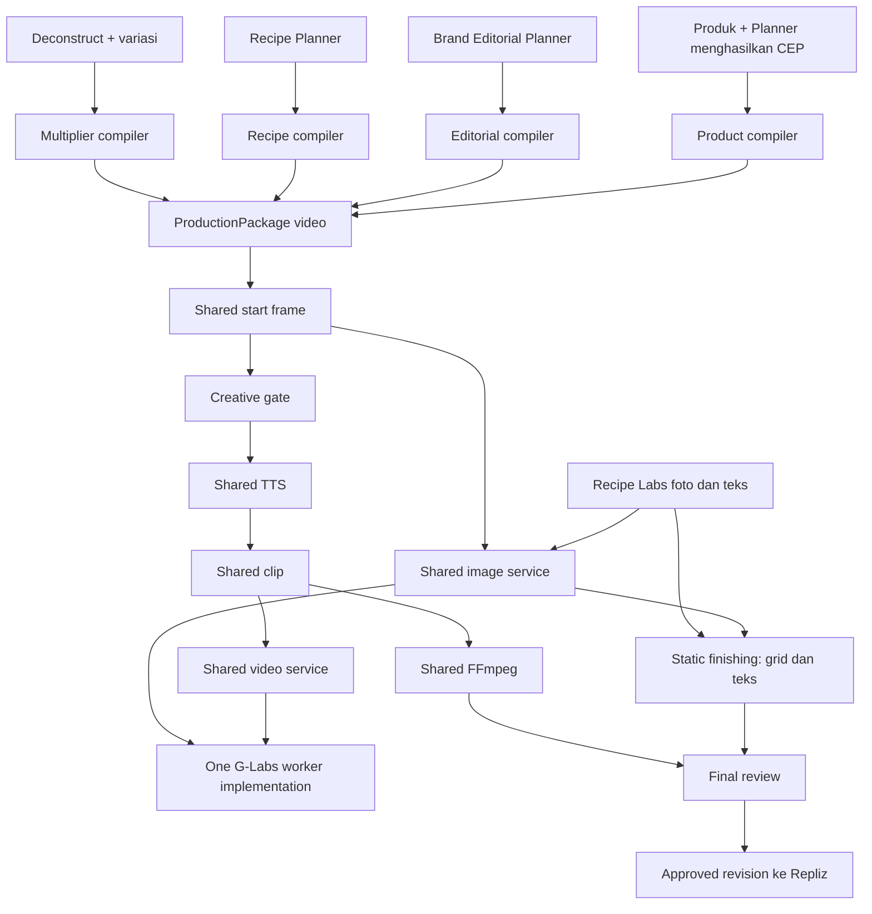

# Implementation Plan — CF Studio V3

**Tanggal:** 1 November 2026
**Basis:** PRD versi 1.6 (`sot/cf-studio-v3/PRD.md`)
**Revisi:** 1.1 — diperjelas setelah audit pipeline produksi bersama.
**Status:** Eksekusi dimulai. Fondasi aplikasi lokal terverifikasi; migrasi apply dan provider belum berjalan.

## 1. Hasil akhir dan batas kerja

Membangun aplikasi baru CF Studio V3 dengan menu Product Database, Deconstruct Lab, Brand Profile Manager (termasuk Visual Identity dan Preset), Setting, dan Automation. Automation mempunyai empat tab: Setting Automation, Daily Review, Schedule, History.

Kelima jalur produksi: Multiplier, Recipe Campaign video, Recipe Labs foto/teks, Brand Editorial video, dan Product Campaign video. Product Campaign mewajibkan produk; Content Planner menghasilkan CEP secara otomatis. Semua publikasi memerlukan approval final versi konten oleh manusia yang berizin.

Migrasi yang wajib: Deconstruct Lab, Product Database, Visual Identity, Preset Manager, dan Brand Profile dari default tenant MAKNA Flow V2 ke default tenant CF Studio, termasuk relasi dan media terkait.

Rencana ini tidak memulai coding aplikasi, panggilan AI, migrasi database, pemindahan media, atau deployment. Root `implementation_plan.md` milik tugas sebelumnya tidak ditimpa. Sumber V2 tetap dipertahankan.

## 2. Keputusan arsitektur dan asumsi

1. **Aplikasi terpisah:** usulkan repository CF Studio tersendiri. Lokasi checkout, remote, URL, port, dan host deployment ditetapkan sebelum bootstrap; tidak mengarang target tersebut. Semua path aplikasi pada bagian 12 relatif terhadap root repository baru ini, bukan instruksi menulis ke root MAKNA Flow.
2. **Fondasi kompatibel terlebih dahulu:** gunakan versi framework/runtime yang kompatibel dengan modul V2; kunci versi dalam lockfile. Jangan sekaligus melakukan major upgrade framework. Dokumentasi Next.js terpasang telah ditinjau untuk konteks awal; baca guide routing, auth, server/client boundary, dan deployment yang relevan lagi saat tahap coding.
3. **PostgreSQL terisolasi:** usulkan database khusus CF Studio dengan role aplikasi/migrasi sendiri. Jika infrastruktur mengharuskan schema terpisah, hindari fallback ke tabel operasional V2 melalui `public`; uji resolusi tabel dan grants. Akun pembaca migrasi hanya membaca sumber.
4. **Mesin diadopsi, navigasi disederhanakan:** pertahankan processor produksi terpilih, gunakan compiler/normalizer per sumber sampai paket produksi standar; tahap rendering hanya satu implementasi bersama. Tidak perlu memindahkan semua halaman/menu V2.
5. **Worker terpisah dari web:** proses web tidak otomatis menyalakan scheduler saat boot. Worker CF Studio memiliki antrean, lease, identitas, media namespace, dan konfigurasi sendiri. Callback G-Labs/provider harus memiliki routing namespace CF Studio; ID task tidak boleh bertabrakan dengan V2.
6. **Snapshot berversi:** run merujuk revisi rutinitas aktif, konfigurasi brand/produk/preset/sumber pada saat dispatch. Perubahan draft tidak mengubah run berjalan.
7. **Keputusan tetap terbuka:** default creative approval otomatis/manual, login import/SSO, self-approval, batas kapasitas/biaya/retensi, dan kemampuan akun Repliz. Ditutup sebelum fase yang bergantung padanya, bukan sebelum seluruh pekerjaan bisa dimulai.

## 3. Temuan awal yang memengaruhi implementasi

| Temuan V2 | Implikasi untuk CF Studio |
|---|---|
| `lib/tenant-context.js` mempunyai fallback default tenant | Ganti dengan tenant context wajib pada jalur aplikasi/worker; default tenant bukan fallback untuk request tak dikenal |
| `lib/db-pg.js` mempunyai konfigurasi koneksi fallback, penambahan `public` ke search path, dan migrasi saat startup | Jangan menyalin apa adanya; wajib konfigurasi eksplisit, role terbatas, migrasi terpisah, tanpa credential literal |
| `instrumentation.js` menyalakan beberapa layanan latar belakang | Jangan menyalinnya sebagai bootstrap CF Studio; web dan worker dipisahkan |
| Automation contract V2 berorientasi operator request dan memiliki pembatasan pilot | Perlu model rutinitas multi-target dan adapter; jangan sekadar menambah opsi dropdown |
| Multiplier menggunakan hasil deconstruct; jalur resep/video memiliki processor berbeda | Validasi sumber berdasarkan jalur, bukan satu field sumber generik untuk semua |
| Auth V2 memiliki role admin/superadmin, menu permission dan brand assignment | Pertahankan kompatibilitas identitas, tambah capability server-side dan pengujian akses objek |
| Exact revision approval sudah tersedia pada beberapa jalur V2 | Adopsi invariant tersebut, perluas ke approval final dan publishing intent |
| PRD menetapkan media sebagai bagian migrasi | Inventaris database saja tidak cukup; perlu manifest media, dependency, serta verifikasi akses/checksum |

Temuan berasal dari inspeksi kode, bukan audit database atau verifikasi layanan hidup. Jumlah data, ukuran media, kelengkapan dependency, dan throughput belum diketahui.

## 4. Urutan implementasi dan keluaran tiap fase

### Fase 0 — Baseline, dependency dan keputusan operasional

- Catat commit SHA sumber V2, dependency terpakai, skema/tabel aktual, provider, callback, storage, dan proses yang berjalan.
- Inventaris lima domain default tenant secara read-only: jumlah, foreign/reference dependencies, status arsip, duplikasi dan media.
- Pastikan apakah data operasional yang ingin diimpor berasal dari schema dev/staging/public atau lingkungan lain; jangan menganggap default tenant identik pada semua schema.
- Petakan preset sistem/global dan dependency universe/karakter serta assignment yang dibutuhkan tanpa membawa objek tenant lain.
- Selesaikan lokasi repository baru, ruang database/storage, host/port, dan login baseline.

**Keluaran:** manifest adopsi berisi file+SHA, dependency map, laporan inventaris tanpa secret, decision log, serta baseline pengujian mesin.
**Gate:** tidak ada mutasi database sumber; tidak ada worker CF Studio terhubung ke antrean V2.

### Fase 1 — Mockup seluruh flow dan kontrak

- Perluas mockup HTML standalone yang sudah ada agar menampilkan tepat empat tab Automation; gunakan mockup Fase 1 yang memodelkan History sebagai timeline event.
- Lengkapi state draf/aktif/revisi belum diterapkan, lima jalur, CEP otomatis, creative review, final review, kalender, riwayat dan keadaan gagal.
- Tambahkan simulasi role/capability, konteks tenant/brand, media hilang dan konflik import pada materi review bila diperlukan.
- Tunjukkan mockup untuk review pengguna sebelum menulis/mengubah komponen React terkait, sesuai SOP.
- Tetapkan kontrak API, state transition dan error taxonomy per domain. Kontrak membedakan draft save, activation, run once dan publishing.

**Keluaran:** mockup reviewable, daftar keputusan UI yang diterima, kontrak data/API.
**Gate:** mockup alur UI disimulasikan kepada pengguna sebelum coding UI utama. Persetujuan produk yang belum jelas ditandai dan tidak diasumsikan.

### Fase 2 — Bootstrap aplikasi, database dan akses

- Buat repository/checkout baru dan branch dengan prefix `codex/`; identitas produk CF Studio V3. Nomor versi aplikasi baru tidak memakai nomor patch MAKNA Flow.
- Setup Next.js, konfigurasi eksplisit, semantic theme tokens V2, layout lima menu, error handling dan logging terstruktur.
- Buat migration runner terpisah, tabel tenant/user/permission dan default tenant tujuan. Tidak ada auto-migration ketika build/web boot.
- Adopsi sesi/auth V2 sesuai keputusan login; tambah capability dan scope brand/tenant pada API, worker dan URL media.
- Siapkan worker entrypoint, tetapi execution/provider dispatch tetap OFF sampai gate kesiapan.

**Keluaran:** aplikasi dapat login, navigasi dan tenant context benar, database terisolasi, build lulus.
**Gate:** uji akses lintas tenant dan role lulus sebelum memuat katalog migrasi ke UI.

### Fase 3 — Menu adopsi dan trial migration

- Adopsi Product Database dan Deconstruct Lab dengan service/API/UI yang diperlukan.
- Adopsi Brand Profile Manager sebagai daftar brand. Klik nama membuka detail brand dengan tab Preset (default) dan Visual Identity. Profil/produk melalui Edit Brand/area informasi; bukan tab utama tambahan. Pisahkan preset tenant dari preset sistem baca-saja dan validasi assignment per brand.
- Buat migrator: inventory → plan/dry-run → snapshot/export → import dependencies/objects → media → relink → reconcile.
- Tentukan urutan berdasarkan graph relasi aktual. Relasi siklik ditangani dua tahap: objek dasar dulu, kemudian binding/reference.
- Gunakan origin key unik per sistem+tenant+domain+ID sumber. Simpan import batch, pemetaan ID, hash/revisi sumber dan konflik tujuan.
- Trial import ke database CF Studio disposable, ulangi import untuk membuktikan idempotensi. Delta tidak menimpa edit tujuan tanpa resolusi eksplisit.

**Keluaran:** kelima menu/domain dapat digunakan pada data trial, laporan relasi/media/konflik, runbook migrasi.
**Gate:** manifest lengkap dan tidak ada dangling reference internal yang dianggap berhasil. Dependency kritis hilang membuat objek belum siap produksi.

### Fase 4 — Rutinitas dan jadwal durable

- Buat routine draft/active revision dan production targets dinamis; produk wajib hanya untuk Product Campaign.
- Terapkan validasi sumber siap, brand-product binding, preset kompatibel, tenant aktif dan capability saat save/activate/run.
- Jadwal timezone-aware, missed-run skip/run-latest, manual run terpisah, pause/archive dan batas concurrency.
- Claim run dengan unique slot key, transaksi/lease, checkpoint, recovery dan pembatalan; jangan menggunakan timer memori sebagai satu-satunya sumber jadwal.
- Update draft rutinitas aktif tidak otomatis mengganti revisi aktif; tampilkan pending changes.

**Keluaran:** empat tab dasar memakai data nyata; routine run dapat diklaim tepat sekali per slot saat dua worker bersaing.
**Gate:** restart, crash di batas transaksi dan konflik edit tidak menciptakan run ganda.

### Fase 5 — Kompilasi materi dan konsolidasi pipeline bersama

**Dasar keputusan:** `production_pipeline_audit.md`. Lima jalur bukan lima worker G-Labs. Empat jalur video memakai compiler berbeda dan satu shared production pipeline. Resep foto/teks memakai shared image service + static finishing.

**5A — Characterization sebelum konsolidasi**

- Simpan fixture payload/storyboard/config empat sumber tanpa secret; cocokkan perilaku reference, durasi, voice, visual mode, mux dan recovery.
- Audit dependency shared helper, terutama akses batch TTS/database legacy di fungsi mux, serta format antrean/endpoint provider.
- Tentukan mode dispatch (queue atau direct) eksplisit. Jangan mempertahankan fallback direct saat enqueue gagal yang dapat mem-bypass antrean.

**5B — Kontrak paket dan compiler**

- Kontrak `ProductionPackage v1` berisi revision/fingerprint, scene IDs, prompt/mode/durasi/reference, voice/segments/fallback, kebijakan kreatif, mux settings dan metadata output.
- Compiler Multiplier: deconstruct + variation → materi kreatif → normalizer paket.
- Compiler Recipe video: Recipe Planner → recipe creative adapter → normalizer paket.
- Compiler Brand Editorial: Content Planner editorial → creative generator → normalizer paket.
- Compiler Product Campaign: produk → Content Planner CEP otomatis dan plan → creative generator → normalizer paket.
- Builder Recipe statis: Recipe Labs → teks + image requests; output kind static.
- Compiler tidak submit gambar/video, membuat audio atau memanggil FFmpeg. Source kind hanya menentukan compiler dan lineage, bukan metode render.

**5C — Shared execution**

- Start frame: lifecycle asset/revision/checkpoint/lane dari fondasi Pillar digeneralisasi, memakai shared image service.
- TTS: satu executor untuk single/multi-voice, MiniMax/Gemini, fallback dan language/model/speed/volume.
- Clip: satu executor I2V/T2V, persisting task ID/endpoint, reconcile sebelum retry dan reuse scene selesai.
- FFmpeg: satu executor dengan manifest audio/video eksplisit, Smart Sync, bridge, scale, BGM/SFX dan validasi completeness. Dukungan native audio/TTS-off harus eksplisit.
- G-Labs: satu jenis worker/gateway image/video, dapat beberapa instance; identitas tenant dari payload diperiksa dan tenant context dipasang. Secret diselesaikan server-side melalui connection reference.
- Coordinator stage tidak menjadi submitter/poller kedua. Gunakan stage lease+heartbeat+fencing token agar hasil stale worker tidak mengubah revision aktif.
- Static finishing: grid/layout/text/export setelah shared image service. Lewati TTS/clip/mux.

**5D — Pembuktian paritas**

- Fake provider membandingkan request/manifest dari package setara untuk empat sumber; jangan membandingkan byte hasil AI nondeterministik.
- Uji retry satu scene, reference kritis, dialog/multi-voice, fallback codec, zero-valued settings, T2V/I2V, approval dan pemulihan submit ambigu.
- Setelah tes kontrak lulus, satu item nyata per capability/jalur pada tenant uji, lalu pilot batch.

**Keluaran:** compiler berbeda, satu kode render bersama, manifest artifact standar.
**Gate:** CF Studio tidak memiliki renderer Multiplier/Pillar terpisah permanen; normalizer menjaga paritas fitur V2, dan provider worker tidak digandakan per source kind. Tidak ada perubahan mesin V2 asli dalam konsolidasi ini.

### Fase 6 — Daily Review, approval dan Telegram

- Render video asli/foto/grid, resep lengkap, metadata sosial, target/planner/source lineage, produk dan CEP hasil mesin.
- Creative approval mengikuti keputusan kebijakan; persetujuan otomatis dicatat sebagai sistem berbasis versi preset.
- Approval final selalu manusia, cocokkan revision/hash dan capability brand; edit/regenerasi membuat revision baru dan menginvalidasi approval sebelumnya.
- Bulk approval melaporkan hasil per item, bukan menyembunyikan partial failure.
- Outbox Telegram, verifikasi penerima, preferensi/quiet hours, batch deep-link terautentikasi dan deduplikasi event.
- Pisahkan failure produksi, publishing dan notifikasi.

**Keluaran:** user dapat review sebagian batch, meminta revisi dan menyetujui versi final.
**Gate:** stale approval, akses reviewer brand lain, dan edit setelah approval ditolak/ditangani dengan benar.

### Fase 7 — Schedule, Repliz dan History

- Implementasi publishing intent lokal untuk versi disetujui, akun tujuan dan waktu; preflight sebelum dispatch.
- Uji format media/platform, akses media, judul/caption, token akun dan kemampuan reschedule/cancel yang benar-benar tersedia.
- Rekonsiliasi respons ambigu sebelum retry; satu intent tidak membuat kiriman ganda setelah timeout.
- Schedule memisahkan status lokal dan provider. Published hanya berdasarkan bukti provider, bukan request diterima.
- Perubahan konten yang sudah diterima provider memerlukan pembatalan/pembaruan terkonfirmasi; revisi lokal tidak diam-diam mengganti jadwal lama.
- History menggabungkan run, stage, revision, keputusan, publishing attempt, notification dan audit dengan filter.

**Keluaran:** alur produksi → review → schedule → status provider end-to-end, audit dapat ditelusuri.
**Gate:** production posting tidak dipakai sebagai pengujian tanpa otorisasi tujuan/konten; gunakan akun uji/sandbox jika didukung. Mock provider menguji failure terlebih dahulu.

### Fase 8 — Final migration, pilot dan release

- Ulangi inventory dan dry-run pada sumber/tujuan final; backup dan manifest disiapkan.
- Ambil snapshot konsisten dan tangani delta atau jeda edit terkoordinasi pada lima domain; jangan menghentikan aplikasi V2 secara keseluruhan tanpa kebutuhan.
- Jalankan final import, verifikasi seluruh origin keys, counts, binding/reference, file/checksum, URL eksternal dan exception report.
- Jalankan pilot Nutribake 2 Multiplier + 2 Recipe video + 2 resep foto/teks; uji Brand Editorial dan Product Campaign dalam batch terkontrol.
- Ukur kapasitas/antrean, biaya dan ketepatan dispatch sebelum menaikkan jumlah atau tenant.
- Siapkan dokumentasi operasional, restore drill dan release. CI/build tidak memigrasikan DB atau menyalakan worker.

**Keluaran:** pilot berfungsi, katalog default tenant utuh/pengecualian dijelaskan, paket rilis dan runbook siap.
**Gate:** deployment production hanya setelah instruksi manual eksplisit pengguna; aplikasi baru tidak memakai folder/port/proses V2 tanpa konfigurasi yang disepakati.

## 5. Strategi migrasi dan pemulihan

- Source environment dan source/default tenant ID diverifikasi secara eksplisit; source connection read-only.
- Destination database/schema/tenant/media namespace diverifikasi sebelum apply. Tolak sumber=tujuan.
- Manifest memisahkan object status, media status dan usability; status berhasil tidak diberikan hanya karena INSERT berhasil.
- Inventory/export/import berjalan berbatas batch dengan checkpoint; media dapat dilanjutkan tanpa menyalin ulang file yang sudah cocok.
- Preset global dipetakan berdasarkan key+versi kompatibel, bukan sekadar nama. Dependency lintas tenant tidak ikut diimpor.
- Tidak mengimpor credentials, sessions, antrean aktif, rutinitas aktif atau jadwal Repliz. Import tidak memanggil AI, mengirim pesan atau publishing.
- Pemulihan mengacu import batch dan hanya boleh mengubah objek yang masih cocok dengan fingerprint hasil import. Objek yang sudah diedit/dipakai CF Studio menjadi konflik yang memerlukan resolusi.
- Checksum untuk file yang disalin, access check untuk referensi eksternal, dan laporan media hilang. Sumber V2 tidak dihapus.

## 6. Kontrak API dan keamanan

Gunakan API versioned CF Studio; nama endpoint final dikunci pada fase 1. Keluarga endpoint:

| Area | Tindakan |
|---|---|
| Catalogs | CRUD produk, deconstruct, brand, visual identity, preset dan binding |
| Routines | Save draft, target CRUD, activate revision, pause, archive, run once |
| Runs/items | Read progress, retry stage, cancel, edit revision, creative/final review |
| Publishing | Preflight, create intent, reschedule, cancel, reconcile |
| Notifications | Connect/verify Telegram, preferences, authorized test |
| History/admin | Audit, import report, tenant/user/brand capability |

Mutasi menerima expected revision atau ETag untuk mencegah lost update; create/dispatch menggunakan idempotency key. Semua objek diperiksa tenant+brand+capability di server. Worker memeriksa kembali kebijakan aktif sebelum memulai side effect baru. Tanggapan API tidak menyertakan secret atau log mentah.

## 7. Verifikasi dan Definition of Done

| Kelompok | Pengujian yang diperlukan |
|---|---|
| Kontrak | Lima jenis target, produk wajib, CEP tanpa input manual, source/preset valid |
| Scheduler | Timezone, missed slots, run once, dua worker, lease expiry, restart dan checkpoint |
| Tenant/izin | Dua tenant dan dua brand, ID tebakan, media URL, bulk endpoint, superadmin context, tenant suspended |
| Revisi | Draft vs active, stale edit/approval, regenerate, approval hash dan publishing snapshot |
| Migrasi | Dry-run tidak mutate, rerun tanpa duplikat, delta conflict, dependency siklik, media hilang, resume dan rollback terbatas |
| Paritas produksi | Empat source kind dengan paket ekuivalen memakai request/mux sama; multi-voice, I2V/T2V, reference, fallback dan static skip terjaga |
| Provider | Fake timeout/transient/permanent/unknown outcome, callback duplikat, reconnect, format media dan rate limit |
| UI | Review manual pengguna pada mockup dan aplikasi; light/dark, mobile, keyboard dan state gagal |
| Integrasi nyata | Satu item valid per jalur sebelum batch pilot; Telegram dan Repliz pada tujuan uji yang diotorisasi |

Definition of Done tiap fase: hasil fase nyata tersedia, tes bermakna lulus, keterbatasan dicatat, tidak ada secret, checklist diperbarui dan perubahan software dirilis sesuai SOP repository terkait. Build seluruh aplikasi diperlukan setelah perubahan lintas modul; hindari mengulang tes luas yang sudah lulus tanpa perubahan relevan. Tidak membuat tes kosmetik yang hanya menyalin implementasi.

## 8. Rilis dan deployment

- Untuk perubahan software MAKNA Flow yang memang diperlukan, ikuti rilis patch non-interaktif dan sinkronisasi main/tag sesuai AGENTS.md. Batasi staging agar file pekerjaan lain tidak ikut ter-commit.
- CF Studio memiliki version/changelog/tag dan remote sendiri setelah ditetapkan; jangan merilis kode CF Studio ke remote MAKNA Flow secara tidak sengaja.
- Dokumen rencana ini tidak memicu perubahan versi aplikasi karena belum mengimplementasikan fitur/refaktor/bugfix.
- Deployment Dev/Staging Mac Mini harus mengikuti SoT atomic: immutable full SHA tersedia di remote, build remote pada release baru, migrasi otomatis dimatikan, shared mutable paths, PM2 delete/start dengan validasi cwd, health dan rollback.
- Jangan menyalin konfigurasi pool antar aplikasi tanpa anggaran koneksi agregat. Batas V2 tetap dipertahankan; alokasi CF Studio ditetapkan sebelum deployment.
- Tidak melakukan polling SSH loop. Selama remote build tunggu melalui sesi deployment yang sama.
- Pemulihan symlink/file tidak memulihkan database. Migrasi schema/data punya backup, kompatibilitas dan prosedur pemulihan sendiri.

## 9. Keputusan dan dependency yang harus ditutup

| Keputusan | Batas waktu | Default usulan |
|---|---|---|
| Repository/path, host/port, database/storage | Sebelum bootstrap | Aplikasi dan ruang data terpisah |
| Sumber data V2 aktual | Sebelum inventory/migration | Pilih satu environment otoritatif secara eksplisit |
| Login akun | Sebelum auth import | Sesi baru; jangan menyalin token sesi |
| Creative approval | Dikonfirmasi pengguna | Default otomatis berdasarkan preset; bisa manual per rutinitas; final manual selalu |
| Role mapping dan self-approval | Self-approval dikonfirmasi; role mapping diverifikasi saat provisioning | Self-approval boleh dengan izin produksi+approval; scope brand/tenant tetap wajib |
| Kuota, concurrency, retensi | Sebelum provider pilot | Konservatif, berdasarkan inventaris dan pengukuran |
| Provider publishing dan akun uji | Sebelum live integration | Verifikasi kemampuan nyata per akun/media |

Tidak memberikan estimasi kalender sebelum inventaris dependency/data dan kapasitas selesai. Pengerjaan berurutan mengikuti gate; pekerjaan desain kontrak dapat berjalan tanpa menunggu migrasi final. Rencana ini tidak mengasumsikan delegasi ke subagent.

## Execution Task List

Checklist ini wajib diperbarui dari `- [ ]` menjadi `- [x]` setelah setiap tahap benar-benar selesai. Penyusunan rencana tidak menandai implementasi sebagai selesai.

- [x] Baca PRD 1.1, mockup dan modul V2 relevan; identifikasi risiko adopsi.
- [x] Susun rencana fase, pemetaan file, before/after, verifikasi dan gate delivery.
- [x] Fase 0: tetapkan lingkungan/repository, inventaris dependency dan lima domain default tenant; gap media dicatat dan baseline kode dipilih pengguna.
- [x] Fase 1: mockup/kontrak ditampilkan, kebijakan dikonfirmasi; pengguna menginstruksikan lanjut hingga fase terakhir.
- [x] Fase 2: bootstrap aplikasi/database terisolasi, auth/tenant/capability dan worker OFF.
- [x] Fase 3: adopsi menu, trial migration objek/relasi/media, idempotensi dan rekonsiliasi.
- [x] Fase 4: implementasi routine draft/active, target CRUD, schedule/claim/checkpoint.
- [x] Audit statis tahapan V2 dan dokumentasikan bukti, perbedaan capability serta gap queue/lease.
- [ ] Fase 5A: characterization fixtures dan audit dependency shared services/provider transport.
- [x] Fase 5B: kontrak ProductionPackage dan empat compiler video + builder resep statis.
- [x] Fase 5C: shared start-frame/TTS/clip/FFmpeg, satu G-Labs gateway dan static finishing.
- [ ] Fase 5D: uji parity empat sumber, native-audio modes, retry/lease/reference dan provider nyata terkontrol.
- [ ] Fase 6: Daily Review, approval revisi, regenerasi dan Telegram terverifikasi.
- [ ] Fase 7: Repliz preflight/intent/reconcile, Schedule dan History.
- [ ] Fase 8a: final migration lima domain default tenant dan laporan kelengkapan.
- [ ] Fase 8b: pilot lima jalur, failure recovery, isolasi tenant/brand dan kapasitas.
- [ ] Fase 8c: dokumentasi operasi, rilis dan deployment lingkungan yang diotorisasi.

## 10.1. Diagram batas tanggung jawab



Diagram menunjukkan alur default; skip start frame/TTS atau mode native audio ditentukan capability paket dan preset, bukan jalur sumber. Instance worker dapat ditambah tanpa membuat kode renderer per sumber. Shared service berarti kode dan protokol sama; isolation tenant/environment tetap wajib. Koordinasi kapasitas endpoint fisik yang juga dipakai V2 harus disepakati sebelum pilot.

## 11. Cara memakai daftar file

Bagian 12 adalah baseline file yang direncanakan dibuat/diubah. Contoh After merupakan kontrak/desain ilustratif, bukan kode lengkap yang siap dijalankan. Helper yang disebut akan didefinisikan saat implementasi. Untuk file baru, Before adalah belum ada. File V2 yang diadopsi tanpa perubahan dicatat dalam manifest adopsi berdasarkan SHA; bila ternyata perlu diubah, tambahkan file tersebut beserta potongan Before aktual dan After usulan ke rencana ini sebelum edit.

File dokumentasi hasil fase, fixture, dan unit/integration test baru mengikuti daftar baseline. Jika pemetaan teknis memerlukan file tambahan, perbarui daftar serta before/after terlebih dahulu. Jangan menganggap nama file konseptual ini sudah ada di repository CF Studio.

## 12. File Plan — Before & After Code Snippets

### 12.1. `MAKNA Flow: public/mockup_brand_daily_routine.html`

Revisi mockup empat tab sebelum coding UI.

**Code Sebelum (Current/Before)**

```html
<button data-tab="calendar" onclick="showTab('calendar')">03 &nbsp; Jadwal publikasi</button>
```

**Code Sesudah (Proposed/After)**

```html
<button data-tab="calendar">03 Schedule</button>
<button data-tab="history">04 History</button>
```

### 12.2. `CF Studio: docs/adoption-manifest.json`

Catat sumber copy beserta dependency dan efek startup.

**Code Sebelum (Current/Before)**

```text
Belum ada di aplikasi CF Studio baru. Sumber V2 tidak diubah oleh pembuatan file ini.
```

**Code Sesudah (Proposed/After)**

```json
{ "sourceCommit": "VERIFIED_GIT_SHA", "files": [], "sideEffectAudit": [] }
```

### 12.3. `CF Studio: package.json`

Bootstrap runtime/dependency yang dipin setelah audit.

**Code Sebelum (Current/Before)**

```text
Belum ada di aplikasi CF Studio baru. Sumber V2 tidak diubah oleh pembuatan file ini.
```

**Code Sesudah (Proposed/After)**

```json
{ "name": "cf-studio", "version": "3.0.0", "private": true }
```

### 12.4. `CF Studio: next.config.mjs`

Konfigurasi aplikasi terpisah, mengikuti guide versi terpasang.

**Code Sebelum (Current/Before)**

```text
Belum ada di aplikasi CF Studio baru. Sumber V2 tidak diubah oleh pembuatan file ini.
```

**Code Sesudah (Proposed/After)**

```javascript
export default { /* konfigurasi hasil audit kompatibilitas */ };
```

### 12.5. `CF Studio: .env.example`

Nama konfigurasi tanpa nilai secret atau fallback jaringan V2.

**Code Sebelum (Current/Before)**

```text
Belum ada di aplikasi CF Studio baru. Sumber V2 tidak diubah oleh pembuatan file ini.
```

**Code Sesudah (Proposed/After)**

```dotenv
APP_NAME=CF Studio
APP_ROLE=web
DATABASE_URL=
MEDIA_NAMESPACE=cf-studio
ENABLE_PRODUCTION_DISPATCH=false
ENABLE_PUBLISHING_DISPATCH=false
```

### 12.6. `CF Studio: lib/runtime-config.js`

Fail-fast konfigurasi, tanpa menulis credential literal.

**Code Sebelum (Current/Before)**

```text
Belum ada di aplikasi CF Studio baru. Sumber V2 tidak diubah oleh pembuatan file ini.
```

**Code Sesudah (Proposed/After)**

```javascript
export function readConfig(env) {
  if (!env.DATABASE_URL) throw new Error('DATABASE_URL wajib');
  return { databaseUrl: env.DATABASE_URL, appRole: env.APP_ROLE };
}
```

### 12.7. `CF Studio: lib/db-pg.js`

Ganti bootstrap DB V2 berisiko dengan koneksi eksplisit.

**Code Sebelum (Current/Before)**

```text
Belum ada di aplikasi CF Studio baru. Sumber V2 tidak diubah oleh pembuatan file ini.
```

**Code Sesudah (Proposed/After)**

```javascript
export function createAppPool(config) {
  return new Pool({ connectionString: config.databaseUrl, max: config.poolMax });
}
// Migrasi hanya melalui migration runner, bukan startup web.
```

### 12.8. `CF Studio: db/migrations/001_cf_studio.sql`

Tenant, capability, routine revisions, runs, approval, publishing dan import ledger; schema final mengikuti audit. Tambahkan production_packages, scene_assets, provider_jobs dan fencing token pada stage executions.

**Code Sebelum (Current/Before)**

```text
Belum ada di aplikasi CF Studio baru. Sumber V2 tidak diubah oleh pembuatan file ini.
```

**Code Sesudah (Proposed/After)**

```sql
CREATE UNIQUE INDEX automation_run_slot_uq
ON automation_runs (tenant_id, routine_id, scheduled_slot)
WHERE execution_mode = 'scheduled';
-- Tambahkan FK tenant-aware dan migration ledger pada schema final.
```

### 12.9. `CF Studio: scripts/migrate.mjs`

Jalankan migrasi berversi dengan lock eksplisit.

**Code Sebelum (Current/Before)**

```text
Belum ada di aplikasi CF Studio baru. Sumber V2 tidak diubah oleh pembuatan file ini.
```

**Code Sesudah (Proposed/After)**

```javascript
await withMigrationLock(async () => {
  await applyPendingMigrations({ database: targetDatabase });
});
```

### 12.10. `CF Studio: lib/access-control.js`

Server-side tenant, brand, capability untuk API dan worker.

**Code Sebelum (Current/Before)**

```text
Belum ada di aplikasi CF Studio baru. Sumber V2 tidak diubah oleh pembuatan file ini.
```

**Code Sesudah (Proposed/After)**

```javascript
export async function assertAccess(actor, object, capability) {
  assertTenant(actor.tenantId, object.tenantId);
  await assertBrandAssignment(actor, object.brandId);
  assertCapability(actor, capability);
}
```

### 12.11. `CF Studio: lib/auth.js`

Adopsi sesi V2 dengan pemeriksaan izin baru.

**Code Sebelum (Current/Before)**

```text
Belum ada di aplikasi CF Studio baru. Sumber V2 tidak diubah oleh pembuatan file ini.
```

**Code Sesudah (Proposed/After)**

```javascript
export async function authorize(request, capability) {
  const actor = await requireSession(request);
  await requireActiveTenant(actor);
  return requireCapability(actor, capability);
}
```

### 12.12. `CF Studio: lib/tenant-context.js`

Hilangkan fallback default tenant pada salinan modul.

**Code Sebelum (Current/Before)**

```text
Belum ada di aplikasi CF Studio baru. Sumber V2 tidak diubah oleh pembuatan file ini.
```

**Code Sesudah (Proposed/After)**

```javascript
export function getActiveTenantId() {
  const tenantId = tenantContext.getStore();
  if (!tenantId) throw new Error('TENANT_CONTEXT_REQUIRED');
  return tenantId;
}
```

### 12.13. `CF Studio: app/layout.js`

Shell baru; menu adopsi dan Automation, bukan semua menu V2.

**Code Sebelum (Current/Before)**

```text
Belum ada di aplikasi CF Studio baru. Sumber V2 tidak diubah oleh pembuatan file ini.
```

**Code Sesudah (Proposed/After)**

```jsx
export default function Layout({ children }) {
  return <html lang="id"><body><StudioShell>{children}</StudioShell></body></html>;
}
```

### 12.14. `CF Studio: app/theme.css`

Salin semantic tokens terverifikasi V2 tanpa warna ad-hoc.

**Code Sebelum (Current/Before)**

```text
Belum ada di aplikasi CF Studio baru. Sumber V2 tidak diubah oleh pembuatan file ini.
```

**Code Sesudah (Proposed/After)**

```css
:root { /* token resmi disalin dari app/theme.css V2 */ }
[data-theme="light"] { /* token light resmi V2 */ }
.panel { background: var(--surface); color: var(--text-primary); }
```

### 12.15. `CF Studio: lib/catalog-service.js`

Facade domain menu adopsi; setiap query tenant/brand-aware.

**Code Sebelum (Current/Before)**

```text
Belum ada di aplikasi CF Studio baru. Sumber V2 tidak diubah oleh pembuatan file ini.
```

**Code Sesudah (Proposed/After)**

```javascript
export async function getCatalogItem(actor, domain, id) {
  const item = await repository(domain).findInTenant(actor.tenantId, id);
  await assertAccess(actor, item, domain + ".read");
  return item;
}
```

### 12.16. `CF Studio: app/products/page.js`

Adopsi Product Database setelah dependency audit.

**Code Sebelum (Current/Before)**

```text
Belum ada di aplikasi CF Studio baru. Sumber V2 tidak diubah oleh pembuatan file ini.
```

**Code Sesudah (Proposed/After)**

```jsx
export default async function ProductsPage() {
  const actor = await requirePageAccess("products.read");
  return <ProductDatabase items={await listProducts(actor)} />;
}
```

### 12.17. `CF Studio: app/deconstruct/page.js`

Adopsi Deconstruct Lab dengan sumber siap Multiplier.

**Code Sebelum (Current/Before)**

```text
Belum ada di aplikasi CF Studio baru. Sumber V2 tidak diubah oleh pembuatan file ini.
```

**Code Sesudah (Proposed/After)**

```jsx
export default async function DeconstructPage() {
  const actor = await requirePageAccess("deconstruct.read");
  return <DeconstructWorkspace assets={await listAssets(actor)} />;
}
```

### 12.18. `CF Studio: app/brands/page.js`

Brand manager menggabungkan produk, identity dan preset.

**Code Sebelum (Current/Before)**

```text
Belum ada di aplikasi CF Studio baru. Sumber V2 tidak diubah oleh pembuatan file ini.
```

**Code Sesudah (Proposed/After)**

```jsx
export default function BrandsPage() {
  return <BrandList onSelectBrand={openBrandDetail} />;
  // Detail brand: <BrandDetail tabs={["Preset", "Visual Identity"]} />
}
```

### 12.19. `CF Studio: app/settings/page.js`

User/tenant/integrasi mengikuti capability.

**Code Sebelum (Current/Before)**

```text
Belum ada di aplikasi CF Studio baru. Sumber V2 tidak diubah oleh pembuatan file ini.
```

**Code Sesudah (Proposed/After)**

```jsx
export default async function SettingsPage() {
  return <SettingsWorkspace capabilities={await getPageCapabilities()} />;
}
```

### 12.20. `CF Studio: lib/automation-contract.js`

Model lima target; CEP selalu hasil planning.

**Code Sebelum (Current/Before)**

```text
Belum ada di aplikasi CF Studio baru. Sumber V2 tidak diubah oleh pembuatan file ini.
```

**Code Sesudah (Proposed/After)**

```javascript
const kinds = ['multiplier', 'recipe_video', 'recipe_static', 'brand_editorial', 'product_campaign'];
export function validateTarget(target) {
  assertKnownKind(target.kind, kinds);
  if (target.kind === 'product_campaign') requireProduct(target.productId);
  if ('cep' in target) throw new Error('CEP_IS_PLANNER_OUTPUT');
}
```

### 12.21. `CF Studio: lib/automation-service.js`

Draft save berbeda dari activation; revision guard.

**Code Sebelum (Current/Before)**

```text
Belum ada di aplikasi CF Studio baru. Sumber V2 tidak diubah oleh pembuatan file ini.
```

**Code Sesudah (Proposed/After)**

```javascript
export async function activateRoutine(actor, id, revision) {
  return transaction(async tx => {
    const draft = await tx.lockRoutineRevision(actor.tenantId, id, revision);
    await validateActivation(actor, draft);
    return tx.setActiveRevision(id, revision);
  });
}
```

### 12.22. `CF Studio: lib/automation-repository.js`

Claim durable atomik, unique slot dan lease.

**Code Sebelum (Current/Before)**

```text
Belum ada di aplikasi CF Studio baru. Sumber V2 tidak diubah oleh pembuatan file ini.
```

**Code Sesudah (Proposed/After)**

```javascript
export async function claimRun(workerId) {
  return transaction(tx => tx.claimDueRun({
    workerId, lockMode: "SKIP LOCKED", requireActiveTenant: true
  }));
}
```

### 12.23. `CF Studio: lib/production-adapters.js`

Registry compiler kreatif; bukan registry renderer per jalur.

**Code Sebelum (Current/Before)**

```text
Belum ada di aplikasi CF Studio baru. Sumber V2 tidak diubah oleh pembuatan file ini.
```

**Code Sesudah (Proposed/After)**

```javascript
export const compilers = {
  multiplier: multiplierCompiler, recipe_video: recipeCompiler,
  recipe_static: staticRecipeBuilder, brand_editorial: editorialCompiler,
  product_campaign: productCompiler
};
// Masing-masing hanya menghasilkan ProductionPackage; tidak render.
```

### 12.24. `CF Studio: lib/production-worker.js`

Checkpoint, provider reconcile dan retry stage.

**Code Sebelum (Current/Before)**

```text
Belum ada di aplikasi CF Studio baru. Sumber V2 tidak diubah oleh pembuatan file ini.
```

**Code Sesudah (Proposed/After)**

```javascript
export async function executeClaim(claim) {
  return withRequiredTenant(claim.tenantId, async () => {
    const pkg = await loadValidatedPackage(claim.packageId, claim.revision);
    // Pilih tahap dari capability/manifest; bukan dari source kind.
    return sharedPipeline.executeNextCheckpoint(pkg, claim);
  });
}
```

### 12.25. `CF Studio: scripts/worker.mjs`

Worker process terpisah dari Next web.

**Code Sebelum (Current/Before)**

```text
Belum ada di aplikasi CF Studio baru. Sumber V2 tidak diubah oleh pembuatan file ini.
```

**Code Sesudah (Proposed/After)**

```javascript
const config = readConfig(process.env);
assertWorkerRole(config);
await startOwnedWorkers({ queueNamespace: 'cf-studio', dispatchEnabled: config.dispatchEnabled });
```

### 12.26. `CF Studio: app/automation/page.js`

Empat tab tepat sesuai PRD.

**Code Sebelum (Current/Before)**

```text
Belum ada di aplikasi CF Studio baru. Sumber V2 tidak diubah oleh pembuatan file ini.
```

**Code Sesudah (Proposed/After)**

```jsx
export default function AutomationPage() {
  return <AutomationWorkspace tabs={["Setting Automation", "Daily Review", "Schedule", "History"]} />;
}
```

### 12.27. `CF Studio: app/api/v3/[...segments]/route.js`

Router API dengan handler per domain terotorisasi; pecah file bila perlu saat kontrak dikunci.

**Code Sebelum (Current/Before)**

```text
Belum ada di aplikasi CF Studio baru. Sumber V2 tidak diubah oleh pembuatan file ini.
```

**Code Sesudah (Proposed/After)**

```javascript
export async function POST(request, context) {
  const { segments } = await context.params;
  return dispatchAuthorizedMutation({ request, segments });
}
```

### 12.28. `CF Studio: lib/review-service.js`

Exact revision approval dan audit.

**Code Sebelum (Current/Before)**

```text
Belum ada di aplikasi CF Studio baru. Sumber V2 tidak diubah oleh pembuatan file ini.
```

**Code Sesudah (Proposed/After)**

```javascript
export async function approveFinal(actor, itemId, revision) {
  return transaction(async tx => {
    const item = await tx.lockItem(actor.tenantId, itemId);
    await assertAccess(actor, item, "content.approve");
    assertExactRevision(item, revision);
    return tx.recordHumanApproval(item, revision, actor.id);
  });
}
```

### 12.29. `CF Studio: lib/notification-service.js`

Outbox, verified recipient dan scope brand.

**Code Sebelum (Current/Before)**

```text
Belum ada di aplikasi CF Studio baru. Sumber V2 tidak diubah oleh pembuatan file ini.
```

**Code Sesudah (Proposed/After)**

```javascript
export async function enqueueReviewNotice(event) {
  const recipients = await verifiedAuthorizedRecipients(event);
  return outbox.insertOnce({ eventKey: event.key, recipients, runId: event.runId });
}
```

### 12.30. `CF Studio: lib/publishing-service.js`

Approval snapshot, preflight dan dedup intent.

**Code Sebelum (Current/Before)**

```text
Belum ada di aplikasi CF Studio baru. Sumber V2 tidak diubah oleh pembuatan file ini.
```

**Code Sesudah (Proposed/After)**

```javascript
export async function createPublishingIntent(actor, input) {
  await assertApprovedRevision(actor, input.itemId, input.revision);
  await preflightMediaAndAccount(actor, input);
  return publishingRepository.createIntentOnce(input);
}
```

### 12.31. `CF Studio: lib/publishing-worker.js`

Respons ambigu tidak langsung membuat jadwal baru.

**Code Sebelum (Current/Before)**

```text
Belum ada di aplikasi CF Studio baru. Sumber V2 tidak diubah oleh pembuatan file ini.
```

**Code Sesudah (Proposed/After)**

```javascript
export async function processIntent(intent) {
  const known = await reconcileProvider(intent);
  if (known.outcome === "unknown") return markNeedsReconciliation(intent);
  return submitOnlyIfNotAccepted(intent, known);
}
```

### 12.32. `CF Studio: lib/history-service.js`

Timeline aman dan scoped.

**Code Sebelum (Current/Before)**

```text
Belum ada di aplikasi CF Studio baru. Sumber V2 tidak diubah oleh pembuatan file ini.
```

**Code Sesudah (Proposed/After)**

```javascript
export async function getHistory(actor, filters) {
  return historyRepository.list({ tenantId: actor.tenantId,
    brandIds: await allowedBrands(actor), filters, redactSecrets: true });
}
```

### 12.33. `CF Studio: lib/import-service.js`

Pemetaan origin ID, conflicts, relink dan manifest.

**Code Sebelum (Current/Before)**

```text
Belum ada di aplikasi CF Studio baru. Sumber V2 tidak diubah oleh pembuatan file ini.
```

**Code Sesudah (Proposed/After)**

```javascript
export async function importObject(source, batch) {
  const origin = [source.system, source.tenantId, source.domain, source.id];
  return importRepository.upsertMapped({ origin, batch,
    conflictPolicy: "report", preserveDestinationEdits: true });
}
```

### 12.34. `CF Studio: scripts/import-default-tenant.mjs`

Dry-run default dan explicit source/destination.

**Code Sebelum (Current/Before)**

```text
Belum ada di aplikasi CF Studio baru. Sumber V2 tidak diubah oleh pembuatan file ini.
```

**Code Sesudah (Proposed/After)**

```javascript
const options = parseImportOptions(process.argv);
await assertDifferentDatastores(options);
await assertVerifiedTenantMapping(options);
await runImport({ ...options, apply: options.apply === true, sideEffects: false });
```

### 12.35. `CF Studio: tests/cf-studio.integration.test.mjs`

Tes invariant lintas modul bermakna, fixture dua tenant.

**Code Sebelum (Current/Before)**

```text
Belum ada di aplikasi CF Studio baru. Sumber V2 tidak diubah oleh pembuatan file ini.
```

**Code Sesudah (Proposed/After)**

```javascript
test("tenant lain tidak dapat menjadwalkan revision yang disetujui", async () => {
  await expectForbidden(() => scheduleAs(otherTenantActor, approvedItem));
});
test("retry import tidak menggandakan origin", verifyIdempotentImport);
test("empat sumber memakai shared renderer yang sama", verifyRenderParity);
```

### 12.36. `CF Studio: docs/operations.md`

Runbook proses, antrean, DB, import dan provider.

**Code Sebelum (Current/Before)**

```text
Belum ada di aplikasi CF Studio baru. Sumber V2 tidak diubah oleh pembuatan file ini.
```

**Code Sesudah (Proposed/After)**

```markdown
# Operasi CF Studio
- Verifikasi target environment dan worker ownership.
- Pisahkan rollback aplikasi, schema, dan import batch.
- Rekonsiliasi provider sebelum mengulangi submission ambigu.
```


## 12A. Tambahan File Plan Setelah Audit

Semua path berikut berada di repository CF Studio baru. Modul V2 asli hanya dibaca sebagai sumber adopsi. Potongan After adalah usulan kontrak, bukan implementasi selesai.

### `CF Studio: lib/production-package.js`

**Code Sebelum (Current/Before)**

```text
Belum ada pada aplikasi CF Studio baru.
```

**Code Sesudah (Proposed/After)**

```javascript
export function validatePackage(pkg) {
  requireStableSceneIds(pkg);
  validateReferencesVoicesAndMux(pkg);
  return freezeAndFingerprint(pkg);
}
```

### `CF Studio: lib/shared-pipeline.js`

**Code Sebelum (Current/Before)**

```text
Belum ada pada aplikasi CF Studio baru.
```

**Code Sesudah (Proposed/After)**

```javascript
export async function executeNextCheckpoint(pkg, claim) {
  const stage = nextReadyStage(pkg, claim.manifest);
  return executeFencedStage(claim, () => stageServices[stage](pkg, claim));
}
```

### `CF Studio: lib/shared-image-service.js`

**Code Sebelum (Current/Before)**

```text
Belum ada pada aplikasi CF Studio baru.
```

**Code Sesudah (Proposed/After)**

```javascript
export async function submitImage(request) {
  await assertReferenceIntegrity(request);
  return providerJobs.submitOnce("image", request);
}
```

### `CF Studio: lib/shared-tts-service.js`

**Code Sebelum (Current/Before)**

```text
Belum ada pada aplikasi CF Studio baru.
```

**Code Sesudah (Proposed/After)**

```javascript
export async function renderSceneAudio(scene, settings) {
  return renderVoiceSegmentsWithExplicitFallback(scene, settings);
}
```

### `CF Studio: lib/shared-clip-service.js`

**Code Sebelum (Current/Before)**

```text
Belum ada pada aplikasi CF Studio baru.
```

**Code Sesudah (Proposed/After)**

```javascript
export async function renderClip(scene, context) {
  await requireStartFrameWhenNeeded(scene);
  return providerJobs.reconcileOrSubmit("video", scene, context);
}
```

### `CF Studio: lib/shared-mux-service.js`

**Code Sebelum (Current/Before)**

```text
Belum ada pada aplikasi CF Studio baru.
```

**Code Sesudah (Proposed/After)**

```javascript
export async function renderFinal(manifest, settings) {
  assertOrderedCompleteManifest(manifest, settings.audioMode);
  return muxPrimitive(manifest, settings);
}
```

### `CF Studio: scripts/glabs-worker.mjs`

**Code Sebelum (Current/Before)**

```text
Belum ada pada aplikasi CF Studio baru.
```

**Code Sesudah (Proposed/After)**

```javascript
await consumeProviderJobs(async job => {
  return withRequiredTenant(job.data.tenantId, () => executeProviderJob(job.data));
});
```

### `CF Studio: lib/provider-jobs.js`

**Code Sebelum (Current/Before)**

```text
Belum ada pada aplikasi CF Studio baru.
```

**Code Sesudah (Proposed/After)**

```javascript
export async function submitOnce(type, request) {
  return persistAndEnqueueThroughOutbox({ type, request, connectionRef: request.connectionRef });
  // Tidak menyimpan secret dalam payload dan tidak fallback direct diam-diam.
}
```

### `CF Studio: lib/static-finishing-service.js`

**Code Sebelum (Current/Before)**

```text
Belum ada pada aplikasi CF Studio baru.
```

**Code Sesudah (Proposed/After)**

```javascript
export async function finishStatic(pkg, manifest) {
  return exportRecipeBundle({ images: manifest.images, text: pkg.recipe, layout: pkg.layout });
}
```

### `CF Studio: tests/production-parity.test.mjs`

**Code Sebelum (Current/Before)**

```text
Belum ada pada aplikasi CF Studio baru.
```

**Code Sesudah (Proposed/After)**

```javascript
test("renderer tidak bercabang atas source kind", verifyEquivalentPackages);
test("stale lease tidak menyelesaikan revision baru", verifyFencedCompletion);
test("static recipe melewati TTS/video/mux", verifyStaticStages);
```

## 13. Pembaruan rencana selama eksekusi

Setelah tiap fase, tandai task selesai, tautkan commit/artefak dan hasil verifikasi. Jika scope, file, urutan dependency atau kontrak berubah, revisi rencana ini sebelum perubahan terkait dilakukan. Pertahankan jejak keputusan yang memengaruhi data, biaya, approval dan publikasi. Jangan mencentang trial/final migration sebelum laporan rekonsiliasi tersedia.

## 14. Eksekusi lokal terkonfirmasi

Root `/Users/sabeqmmursyid/_cfstudio`; sumber database schema staging; tujuan PostgreSQL terpisah. Worker dan provider dispatch OFF hingga gate integrasi. Remote CF Studio belum ditetapkan.

### File tambahan bootstrap

File berikut adalah tambahan manifest sebelum implementasi: `AGENTS.md`, `.gitignore`, `jsconfig.json`, `app/page.js`, `app/globals.css`, `app/Studio.js`, `app/api/health/route.js`, `lib/errors.js`, `lib/security.js`, `lib/schedule.js`, `lib/incidents.js`, `scripts/inventory-source.mjs`, `scripts/verify-environment.mjs`, `scripts/release.mjs`, `README.md`, `CHANGELOG.md`.

### `AGENTS.md`

**Code Sebelum (Current/Before)**
```text
Belum ada pada root proyek kosong.
```
**Code Sesudah (Proposed/After)**
```text
Implementasi fondasi terisolasi sesuai tanggung jawab file; validasi tenant, konfigurasi eksplisit, tanpa dispatch provider.
```

### `.gitignore`

**Code Sebelum (Current/Before)**
```text
Belum ada pada root proyek kosong.
```
**Code Sesudah (Proposed/After)**
```text
Implementasi fondasi terisolasi sesuai tanggung jawab file; validasi tenant, konfigurasi eksplisit, tanpa dispatch provider.
```

### `jsconfig.json`

**Code Sebelum (Current/Before)**
```text
Belum ada pada root proyek kosong.
```
**Code Sesudah (Proposed/After)**
```text
Implementasi fondasi terisolasi sesuai tanggung jawab file; validasi tenant, konfigurasi eksplisit, tanpa dispatch provider.
```

### `app/page.js`

**Code Sebelum (Current/Before)**
```text
Belum ada pada root proyek kosong.
```
**Code Sesudah (Proposed/After)**
```text
Implementasi fondasi terisolasi sesuai tanggung jawab file; validasi tenant, konfigurasi eksplisit, tanpa dispatch provider.
```

### `app/globals.css`

**Code Sebelum (Current/Before)**
```text
Belum ada pada root proyek kosong.
```
**Code Sesudah (Proposed/After)**
```text
Implementasi fondasi terisolasi sesuai tanggung jawab file; validasi tenant, konfigurasi eksplisit, tanpa dispatch provider.
```

### `app/Studio.js`

**Code Sebelum (Current/Before)**
```text
Belum ada pada root proyek kosong.
```
**Code Sesudah (Proposed/After)**
```text
Implementasi fondasi terisolasi sesuai tanggung jawab file; validasi tenant, konfigurasi eksplisit, tanpa dispatch provider.
```

### `app/api/health/route.js`

**Code Sebelum (Current/Before)**
```text
Belum ada pada root proyek kosong.
```
**Code Sesudah (Proposed/After)**
```text
Implementasi fondasi terisolasi sesuai tanggung jawab file; validasi tenant, konfigurasi eksplisit, tanpa dispatch provider.
```

### `lib/errors.js`

**Code Sebelum (Current/Before)**
```text
Belum ada pada root proyek kosong.
```
**Code Sesudah (Proposed/After)**
```text
Implementasi fondasi terisolasi sesuai tanggung jawab file; validasi tenant, konfigurasi eksplisit, tanpa dispatch provider.
```

### `lib/security.js`

**Code Sebelum (Current/Before)**
```text
Belum ada pada root proyek kosong.
```
**Code Sesudah (Proposed/After)**
```text
Implementasi fondasi terisolasi sesuai tanggung jawab file; validasi tenant, konfigurasi eksplisit, tanpa dispatch provider.
```

### `lib/schedule.js`

**Code Sebelum (Current/Before)**
```text
Belum ada pada root proyek kosong.
```
**Code Sesudah (Proposed/After)**
```text
Implementasi fondasi terisolasi sesuai tanggung jawab file; validasi tenant, konfigurasi eksplisit, tanpa dispatch provider.
```

### `lib/incidents.js`

**Code Sebelum (Current/Before)**
```text
Belum ada pada root proyek kosong.
```
**Code Sesudah (Proposed/After)**
```text
Implementasi fondasi terisolasi sesuai tanggung jawab file; validasi tenant, konfigurasi eksplisit, tanpa dispatch provider.
```

### `scripts/inventory-source.mjs`

**Code Sebelum (Current/Before)**
```text
Belum ada pada root proyek kosong.
```
**Code Sesudah (Proposed/After)**
```text
Implementasi fondasi terisolasi sesuai tanggung jawab file; validasi tenant, konfigurasi eksplisit, tanpa dispatch provider.
```

### `scripts/verify-environment.mjs`

**Code Sebelum (Current/Before)**
```text
Belum ada pada root proyek kosong.
```
**Code Sesudah (Proposed/After)**
```text
Implementasi fondasi terisolasi sesuai tanggung jawab file; validasi tenant, konfigurasi eksplisit, tanpa dispatch provider.
```

### `scripts/release.mjs`

**Code Sebelum (Current/Before)**
```text
Belum ada pada root proyek kosong.
```
**Code Sesudah (Proposed/After)**
```text
Implementasi fondasi terisolasi sesuai tanggung jawab file; validasi tenant, konfigurasi eksplisit, tanpa dispatch provider.
```

### `README.md`

**Code Sebelum (Current/Before)**
```text
Belum ada pada root proyek kosong.
```
**Code Sesudah (Proposed/After)**
```text
Implementasi fondasi terisolasi sesuai tanggung jawab file; validasi tenant, konfigurasi eksplisit, tanpa dispatch provider.
```

### `CHANGELOG.md`

**Code Sebelum (Current/Before)**
```text
Belum ada pada root proyek kosong.
```
**Code Sesudah (Proposed/After)**
```text
Implementasi fondasi terisolasi sesuai tanggung jawab file; validasi tenant, konfigurasi eksplisit, tanpa dispatch provider.
```


## 15. Manifest fase data/API

### `db/migrations/001_cf_studio.sql`
**Code Sebelum (Current/Before)**
```text
Belum ada.
```
**Code Sesudah (Proposed/After)**
```text
Implementasi SQL/API/service terotorisasi tenant dan brand sesuai PRD; konfigurasi database eksplisit.
```
### `scripts/migrate.mjs`
**Code Sebelum (Current/Before)**
```text
Belum ada.
```
**Code Sesudah (Proposed/After)**
```text
Implementasi SQL/API/service terotorisasi tenant dan brand sesuai PRD; konfigurasi database eksplisit.
```
### `lib/auth.js`
**Code Sebelum (Current/Before)**
```text
Belum ada.
```
**Code Sesudah (Proposed/After)**
```text
Implementasi SQL/API/service terotorisasi tenant dan brand sesuai PRD; konfigurasi database eksplisit.
```
### `lib/catalog-service.js`
**Code Sebelum (Current/Before)**
```text
Belum ada.
```
**Code Sesudah (Proposed/After)**
```text
Implementasi SQL/API/service terotorisasi tenant dan brand sesuai PRD; konfigurasi database eksplisit.
```
### `lib/automation-service.js`
**Code Sebelum (Current/Before)**
```text
Belum ada.
```
**Code Sesudah (Proposed/After)**
```text
Implementasi SQL/API/service terotorisasi tenant dan brand sesuai PRD; konfigurasi database eksplisit.
```
### `lib/review-service.js`
**Code Sebelum (Current/Before)**
```text
Belum ada.
```
**Code Sesudah (Proposed/After)**
```text
Implementasi SQL/API/service terotorisasi tenant dan brand sesuai PRD; konfigurasi database eksplisit.
```
### `app/api/health/route.js`
**Code Sebelum (Current/Before)**
```text
Belum ada.
```
**Code Sesudah (Proposed/After)**
```text
Implementasi SQL/API/service terotorisasi tenant dan brand sesuai PRD; konfigurasi database eksplisit.
```
### `app/api/v3/[...segments]/route.js`
**Code Sebelum (Current/Before)**
```text
Belum ada.
```
**Code Sesudah (Proposed/After)**
```text
Implementasi SQL/API/service terotorisasi tenant dan brand sesuai PRD; konfigurasi database eksplisit.
```

## 16. Manifest inventory dan provisioning

### `lib/import-service.js`
**Code Sebelum (Current/Before)**
```text
Belum ada.
```
**Code Sesudah (Proposed/After)**
```text
Implementasi inventory read-only, import dry-run, provisioning tujuan atau repository claim terfencing sesuai domain file.
```

### `scripts/inventory-source.mjs`
**Code Sebelum (Current/Before)**
```text
Belum ada.
```
**Code Sesudah (Proposed/After)**
```text
Implementasi inventory read-only, import dry-run, provisioning tujuan atau repository claim terfencing sesuai domain file.
```

### `scripts/import-default-tenant.mjs`
**Code Sebelum (Current/Before)**
```text
Belum ada.
```
**Code Sesudah (Proposed/After)**
```text
Implementasi inventory read-only, import dry-run, provisioning tujuan atau repository claim terfencing sesuai domain file.
```

### `scripts/provision-admin.mjs`
**Code Sebelum (Current/Before)**
```text
Belum ada.
```
**Code Sesudah (Proposed/After)**
```text
Implementasi inventory read-only, import dry-run, provisioning tujuan atau repository claim terfencing sesuai domain file.
```

### `lib/automation-repository.js`
**Code Sebelum (Current/Before)**
```text
Belum ada.
```
**Code Sesudah (Proposed/After)**
```text
Implementasi inventory read-only, import dry-run, provisioning tujuan atau repository claim terfencing sesuai domain file.
```

### `docs/operations.md`
**Code Sebelum (Current/Before)**
```text
Belum ada.
```
**Code Sesudah (Proposed/After)**
```text
Implementasi inventory read-only, import dry-run, provisioning tujuan atau repository claim terfencing sesuai domain file.
```

## 17. Progress eksekusi — 1 November 2026 (snapshot fondasi historis; lihat Execution evidence dan delivery-status untuk status terkini)

### Selesai dan diverifikasi

- [x] Root proyek baru dibuat di `/Users/sabeqmmursyid/_cfstudio`, sumber V2 tidak diubah.
- [x] PRD 1.4 mencatat root, staging sebagai sumber dan database PostgreSQL terpisah sebagai tujuan.
- [x] Mockup empat tab ditampilkan sebelum React UI; aplikasi lokal berisi lima menu dan empat tab Automation.
- [x] Dependency Next.js diperbarui dari kandidat 16.2.5 ke 16.4.3 setelah audit keamanan; audit paket bersih saat verifikasi.
- [x] Verifikasi default tenant staging dan inventaris tabel read-only: 27 produk, 202 deconstruct, 9 batch deconstruct, 7 brand, 6 identity, 23 binding, 21 preset kustom.
- [x] Manifest dependency V2 dibuat beserta hash file; credential dan env sumber tidak disalin.
- [x] Kontrak tenant wajib, capability+brand, paket produksi bersama, target lima jalur, CEP output-only, dan jadwal timezone dibuat.
- [x] Skema SQL dan migration runner ditulis; belum diaplikasikan atau diuji pada database tujuan.
- [x] API sesi, read katalog, simpan draf/activate revision dan final approval service dibuat; belum diuji integrasi DB.
- [x] Dry-run mapper terhadap data staging selesai untuk domain tabel; source transaction read-only, tidak ada penulisan tujuan. Media belum diverifikasi dan relink belum diterapkan.
- [x] 20 tes kontrak/invariant lulus (fake executor/pure functions, bukan tes PostgreSQL/provider hidup).
- [x] Production build Next.js lulus. Health HTTP 200 dan API privat HTTP 503 DATABASE_NOT_CONFIGURED terverifikasi ketika DB belum diisi.
- [x] Worker default OFF dan menolak dispatch sebelum adapter/gate siap.

### Belum selesai — tidak dianggap sebagai fitur produksi siap

- [x] Database/user tujuan disediakan admin melalui environment lokal; akun sumber yang tersedia tidak memiliki CREATE DATABASE.
- [x] Apply skema, provisioning login, tes transaksi PostgreSQL, FK tenant, auth dan CRUD secara end-to-end.
- [ ] Inventaris dependency/media lengkap (lokasi staging, ukuran, checksum, global preset/universe), migrator preset/binding/media, idempotensi apply dan rollback.
- [ ] Adopsi penuh UI dan operasi Product Database, Deconstruct Lab, Visual Identity/Preset Manager; UI sekarang baru fondasi daftar, bukan semua fitur V2.
- [ ] Scheduler loop durable, run once, heartbeat/lease recovery, compiler AI dan shared image/TTS/clip/FFmpeg services nyata. Shared pipeline saat ini kontrak executor terinjeksi; tidak menghasilkan media nyata.
- [ ] Daily Review, Schedule dan History dengan data hasil nyata; tab saat ini empty state yang menyatakan belum aktif.
- [ ] Delivery Telegram/outbox nyata, verifikasi penerima, koneksi Repliz, preflight dan reconciliation. Tes insiden saat ini hanya kontrak deduplikasi/pesan aman.
- [ ] Final migration dan pilot lima jalur sesuai gate PRD.
- [ ] Remote repository CF Studio ditetapkan sebelum push; tidak menggunakan remote MAKNA Flow.

### Bukti

- `docs/source-inventory.json`: kolom/jumlah sumber terverifikasi, tanpa nilai credential/data katalog.
- `docs/adoption-manifest.json`: kandidat adopsi dan hash/dependency.
- `npm test`: 20 lulus.
- `npm run build`: lulus dengan Next.js 16.4.3.
- Preview: `http://127.0.0.1:3100`, mockup: `/mockup_automation.html`.

### Langkah berikutnya setelah environment tujuan tersedia

1. Verifikasi DATABASE_URL berbeda dari sumber dan hak akses hanya database CF Studio.
2. Jalankan migration dry-run/apply pada tujuan dan siapkan admin dengan password dari environment, tanpa menampilkan nilainya.
3. Tes transaksi/isolation dan lanjutkan migrator relasi/media sebelum menampilkan katalog sebagai siap diproduksi.
4. Lanjutkan adapter materi AI dan shared render services dengan fake provider dahulu, kemudian integrasi terkontrol.

## 18. Koreksi kebutuhan — navigasi Brand Profile Manager

Kebutuhan dikonfirmasi pengguna: daftar brand → klik nama brand → detail dengan tab Preset dan Visual Identity. PRD 1.5 bagian 4.1 menjadi acuan; menggantikan usulan tab Overview/Products sebelumnya.

- [x] Perbarui PRD dan usulan struktur detail brand pada rencana.
- [x] Simulasikan daftar/detail brand dan kedua tab pada mockup HTML sebelum perubahan React terkait.
- [x] Implementasikan tautan nama brand, detail dan kembali ke daftar; default tab Preset.
- [x] Hubungkan assignment preset/identity per tenant+brand, termasuk empty state, pemilihan dan capability.
- [x] Uji assignment hasil migrasi, pergantian brand dan penolakan akses lintas brand.

File tambahan yang direncanakan: `app/brands/[brandId]/page.js`. Pada implementasi, UI awal yang berada di `app/Studio.js` perlu mengarahkan nama brand ke halaman tersebut; kondisi saat ini adalah daftar nama noninteraktif. Endpoint katalog perlu filter brand yang telah divalidasi di server, bukan filter UI saja.

### `app/brands/[brandId]/page.js`

**Code Sebelum (Current/Before)**
```text
Belum ada halaman detail brand di fondasi aplikasi.
```

**Code Sesudah (Proposed/After)**
```jsx
export default async function BrandPage({ params }) {
  const { brandId } = await params;
  const brand = await requireAuthorizedBrand(brandId);
  return <BrandDetail brand={brand} tabs={["Preset", "Visual Identity"]} />;
}
```

## 19. Preset hasil impor wajib dapat dipakai tanpa dibuat ulang

- [x] Tegaskan di PRD 1.6 bahwa preset default tenant staging ikut dimigrasikan dan dapat dipilih kembali.
- [x] Lengkapi migrator preset dari `staging.tenant_settings` key `operator_presets_json`, bukan mencari tabel preset kustom yang tidak ada.
- [ ] Ambil seluruh preset pada snapshot final; trial snapshot 21 preset tenant telah diimpor, final cutover masih terbuka.
- [x] Pertahankan key/nama, konfigurasi non-secret, versi tersedia dan kompatibilitas campaign; petakan dependency Visual Identity/produk/brand dengan origin ledger.
- [x] Inventaris preset sistem/bawaan yang tersedia atau dirujuk; petakan key+versi kompatibel dan pertahankan sifat baca-saja.
- [x] Pertahankan assignment brand yang benar-benar tersedia. Preset tanpa assignment tetap di katalog tenant dan dapat dipilih melalui aksi Pilih preset yang sudah ada.
- [ ] Verifikasi bahwa pemilihan preset hasil impor pada brand tidak membuat preset duplikat, tidak mengharuskan input ulang, dan menghasilkan parameter produksi yang setara dengan konfigurasi sumber.
- [ ] Rekonsiliasi seluruh preset terhadap snapshot final; laporkan dependency yang belum cocok tanpa menyatakan preset tersebut siap produksi.

Tidak diperlukan desain ulang preset dari nol. Import apply saat ini belum tersedia dan masih menunggu tahap migrasi relasi/media serta database tujuan, sebagaimana dicatat pada progress eksekusi.

## 20. Eksekusi Fase 0 — audit baseline lengkap

Baseline disetujui pengguna: pengembangan lokal port 3100, storage media terpisah dari V2, login awal akun CF Studio baru dengan role mapping V2. Remote/deployment host ditetapkan sebelum rilis. Sumber tetap staging default tenant, database tujuan khusus.

- [x] Konfirmasi baseline operasional tersebut.
- [x] Refresh snapshot inventory, status arsip/duplikasi, foreign references dan dependency preset.
- [x] Audit referensi media, jumlah/ukuran file lokal atau server sumber serta pengecualian.
- [x] Catat source SHA, closure dependency, callback/provider/storage dan status proses sumber read-only.
- [x] Jalankan baseline tes mesin yang aman tanpa provider dan catat kegagalan sebagai temuan.
- [x] Tulis decision log, gap, adoption manifest dan laporan gate Fase 0.

### `scripts/phase0-audit.mjs`
**Code Sebelum (Current/Before)**
```text
Belum ada audit lengkap Fase 0; inventory awal hanya menghitung tabel utama.
```
**Code Sesudah (Proposed/After)**
```javascript
await source.query('BEGIN ISOLATION LEVEL REPEATABLE READ READ ONLY');
const report = await auditTenantGraphStatusesAndMedia(source, verifiedTenant);
await source.query('ROLLBACK');
await writeSanitizedReport(report);
```

### `docs/phase0-report.md`, `docs/phase0-inventory.json`, `docs/phase0-decisions.md`
**Code Sebelum (Current/Before)**
```text
Belum ada laporan fase 0 lengkap.
```
**Code Sesudah (Proposed/After)**
```text
Bukti baseline, hitungan/relasi/media, keputusan terkonfirmasi, gap, tes dan status gate; tanpa credential/payload privat.
```

### Skrip bukti tambahan Fase 0

File: `scripts/phase0-dependency-audit.py`, `scripts/phase0-server-inspect.py`.

**Code Sebelum (Current/Before)**
```text
Tool audit lokal sementara; belum disimpan di repository CF Studio.
```
**Code Sesudah (Proposed/After)**
```text
Audit literal imports/hash dan inspeksi SSH baca-saja dengan JSON tersaring; tanpa secret, startup worker atau perubahan layanan.
```

Skrip ini untuk inventory. Daftar path media sementara tidak masuk Git. Tidak ada mutasi sumber.

Fase 0 ditutup setelah jawaban pengguna: kode lokal terbaru menjadi baseline adopsi, data tetap staging; 199 referensi file yang belum ditemukan dicatat sebagai gap migrasi. Checklist ini tidak menyatakan migrasi apply atau kelengkapan media selesai. Fase 1 belum dimulai dalam pembaruan keputusan ini.

## 23. Eksekusi Fase 1 — mockup terpadu dan kontrak

- [x] Buat mockup standalone terpisah untuk lima menu dan tepat empat tab Automation.
- [x] Simulasikan draft/active revision, lima jalur, dua lapis review, Telegram error, Schedule dan History.
- [x] Simulasikan daftar brand → detail Preset / Visual Identity, pilihan preset hasil impor dan media gap.
- [x] Tetapkan kontrak API, state transition, error taxonomy dan matriks capability.
- [x] Verifikasi alur kritis secara singkat dan tampilkan mockup kepada pengguna.
- [x] Catat keputusan UI yang sudah terkonfirmasi vs keputusan yang masih perlu review; jangan menganggap ditampilkan berarti disetujui.

### `public/mockup_cfstudio_phase1.html`
**Code Sebelum (Current/Before)**
```text
Belum ada; mockup_automation.html sebelumnya belum memodelkan seluruh menu, history dan active revision secara utuh.
```
**Code Sesudah (Proposed/After)**
```text
Standalone mockup berbasis semantic tokens dengan state simulasi terpisah untuk revision, approval, intent provider, audit dan assignment brand; tanpa panggilan API/AI/publishing.
```

### `docs/phase1-contracts.md`, `docs/phase1-review.md`
**Code Sebelum (Current/Before)**
```text
Kontrak API/state dan daftar keputusan review Fase 1 belum tersedia sebagai dokumen khusus.
```
**Code Sesudah (Proposed/After)**
```text
Kontrak versioned, capability, idempotency, expected revision, transaksi, transition, incident/outbox, error code dan acceptance scenarios; keputusan belum disetujui ditandai eksplisit.
```

### Status hasil Fase 1

Mockup `public/mockup_cfstudio_phase1.html` dan `docs/phase1-contracts.md` siap. Ringkasan pemeriksaan dan keputusan tertunda ada pada `docs/phase1-review.md`. Gate utama Fase 1 tetap menunggu review pengguna dan pilihan creative default/self-approval; tidak dianggap selesai hanya karena prototype ditampilkan. Tidak ada perubahan React/backend/DB/provider pada pengerjaan fase ini.

## 24. Kebijakan approval dikonfirmasi pengguna

- [x] Default creative approval otomatis berdasarkan preset, dapat diubah per rutinitas.
- [x] Self-approval diperbolehkan bagi pengguna yang memiliki capability produksi dan approval; tenant/brand scope tetap berlaku.
- [x] Final approval tetap manual pada revision/fingerprint tepat dan dicatat sebagai keputusan manusia.
- [x] Setelah mockup dan kebijakan, pengguna menginstruksikan lanjut hingga fase terakhir; review estetika UI akhir tetap manual oleh pengguna.

File `public/mockup_cfstudio_phase1.html` — **Code Sebelum (Current/Before)**:
```html
<option value="manual">Manual • storyboard/start frame</option>
<option value="auto">Otomatis • kebijakan preset</option>
```
**Code Sesudah (Proposed/After)**:
```html
<option value="manual">Manual • storyboard/start frame</option>
<option value="auto" selected>Otomatis • kebijakan preset</option>
```
Kontrak/PRD/review diperbarui untuk menghapus status kedua kebijakan sebagai keputusan terbuka. Tidak ada perubahan backend/provider.

## 25. Eksekusi fase 2–8 terotorisasi

Instruksi pengguna: lanjut sampai fase terakhir. Fase 1 diterima sebagai baseline untuk melanjutkan implementasi, dengan perubahan berikutnya tetap dapat direview. Tidak menyimpulkan izin deploy production atau publikasi konten tanpa approval final.

- [x] Terapkan schema operasional, assignment, koneksi terenkripsi, idempotency, notification preference, artifact dan login throttling.
- [x] Uji migrasi SQL pada PostgreSQL terisolasi untuk tes; bukan pengganti pembuktian database tujuan.
- [x] Implementasikan CRUD katalog/brand, preset assignment, user/capability, routine/run/review/publishing/history API.
- [x] Implementasikan import data/preset/binding dengan origin ledger, konflik dan manifest media; source read-only.
- [x] Implementasikan durable scheduler, pipeline per stage dan adapter provider bersama dengan dispatch guards.
- [x] Implementasikan UI aplikasi mengikuti mockup yang telah ditampilkan.
- [ ] Uji integrasi transaksi, isolation, lease/retry, approval/publishing, provider fake; lalu build dan audit.
- [ ] Terapkan ke database tujuan dan uji provider nyata setelah konfigurasi tersedia.
- [ ] Jalankan final migration/pilot/release hanya ketika gate nyata lulus.

### Manifest perubahan sebelum edit


### `db/migrations/002_operations.sql`
**Code Sebelum (Current/Before)**
```text
Belum ada.
```
**Code Sesudah (Proposed/After)**
```text
CREATE TABLE brand_assignments (...); -- FK tenant-aware, unique assignment
CREATE TABLE connections (...); -- secret ciphertext only
-- Add artifact, idempotency, attempts and outbox lifecycle.
```

### `lib/db-pg.js`
**Code Sebelum (Current/Before)**
```text
import pg from 'pg';
import {readConfig} from './runtime-config.js';
let pool;
export function getPool(){if(!pool){const c=readConfig();pool=new pg.Pool({connectionString:c.databaseUrl,max:c.poolMax,connectionTimeoutMillis:8000});}return pool;}
export async function transaction(fn){const client=await getPool().connect();try{await client.query('BEGIN');const value=await fn(client);await client.query('COMMIT');return value;}catch(e){await client.query('ROLLBACK');throw e;}finally{client.release();}}
```
**Code Sesudah (Proposed/After)**
```text
// Implement domain contract with explicit tenant/brand capability,
// durable revision/lease/outbox and provider dispatch checks.
// Return verified result or actionable error; do not fake completion.
```

### `lib/auth.js`
**Code Sebelum (Current/Before)**
```text
import {createHash} from 'node:crypto';
import {getPool} from './db-pg.js';
import {StudioError} from './errors.js';
export async function requireSession(request){const raw=request.headers.get('cookie')||'';const token=raw.split(';').map(x=>x.trim()).find(x=>x.startsWith('cf_session='))?.slice(11);if(!token)throw new StudioError('AUTH_REQUIRED','Silakan login.',401);const hash=createHash('sha256').update(token).digest('hex');const {rows}=await getPool().query('SELECT u.*,t.status AS tenant_status FROM sessions s JOIN users u ON u.id=s.user_id JOIN tenants t ON t.id=u.tenant_id WHERE s.token_hash=$1 AND s.expires_at>now()',[hash]);const u=rows[0];if(!u||u.status!=='active'||u.tenant_status!=='active')throw new StudioError('AUTH_REQUIRED','Sesi tidak aktif.',401);return {id:u.id,tenantId:u.tenant_id,status:u.status,tenantStatus:u.tenant_status,capabilities:u.capabilities,brandIds:u.brand_ids,allBrands:u.all_brands};}
```
**Code Sesudah (Proposed/After)**
```text
// Implement domain contract with explicit tenant/brand capability,
// durable revision/lease/outbox and provider dispatch checks.
// Return verified result or actionable error; do not fake completion.
```

### `lib/access-control.js`
**Code Sebelum (Current/Before)**
```text
import { StudioError } from './errors.js';
export function assertAccess(actor,object,capability){
 if(!actor||actor.status!=='active'||actor.tenantStatus!=='active') throw new StudioError('ACCESS_DENIED','Akses ditolak.',403);
 if(!actor.tenantId||actor.tenantId!==object.tenantId)throw new StudioError('ACCESS_DENIED','Akses ditolak.',403);
 if(!actor.capabilities?.includes(capability))throw new StudioError('CAPABILITY_REQUIRED','Hak tindakan tidak tersedia.',403);
 if(object.brandId&&!actor.allBrands&&!actor.brandIds?.includes(object.brandId))throw new StudioError('BRAND_ACCESS_DENIED','Brand tidak ditugaskan.',403);
```
**Code Sesudah (Proposed/After)**
```text
// Implement domain contract with explicit tenant/brand capability,
// durable revision/lease/outbox and provider dispatch checks.
// Return verified result or actionable error; do not fake completion.
```

### `lib/catalog-service.js`
**Code Sebelum (Current/Before)**
```text
import {getPool} from './db-pg.js';
import {assertAccess} from './access-control.js';
const domains=['product','deconstruct','brand','visual_identity','preset'];
export async function listCatalog(actor,domain){if(!domains.includes(domain))throw new Error('DOMAIN_INVALID');assertAccess(actor,{tenantId:actor.tenantId},'catalog.read');const {rows}=await getPool().query(`SELECT id,domain,brand_id,name,revision,archived,payload FROM catalog_items WHERE tenant_id=$1 AND domain=$2 AND archived=false AND ($3::boolean OR brand_id=ANY($4::text[]) OR (domain='brand' AND id=ANY($4::text[]))) ORDER BY name`,[actor.tenantId,domain,actor.allBrands,actor.brandIds]);return rows;}
```
**Code Sesudah (Proposed/After)**
```text
// Implement domain contract with explicit tenant/brand capability,
// durable revision/lease/outbox and provider dispatch checks.
// Return verified result or actionable error; do not fake completion.
```

### `lib/automation-service.js`
**Code Sebelum (Current/Before)**
```text
import {nextRunAt} from './schedule.js';
import {randomUUID} from 'node:crypto';
import {getPool,transaction} from './db-pg.js';
import {assertAccess} from './access-control.js';
import {validateRoutine} from './automation-contract.js';
import {StudioError} from './errors.js';
```
**Code Sesudah (Proposed/After)**
```text
// Implement domain contract with explicit tenant/brand capability,
// durable revision/lease/outbox and provider dispatch checks.
// Return verified result or actionable error; do not fake completion.
```

### `lib/automation-repository.js`
**Code Sebelum (Current/Before)**
```text
import {transaction} from './db-pg.js';
export async function claimRun(workerId){return transaction(async db=>{const {rows}=await db.query("SELECT r.id FROM automation_runs r JOIN tenants t ON t.id=r.tenant_id WHERE t.status='active' AND (r.status='queued' OR (r.status='processing' AND r.lease_expires_at<now())) ORDER BY r.created_at FOR UPDATE OF r SKIP LOCKED LIMIT 1");if(!rows.length)return null;return (await db.query("UPDATE automation_runs SET status='processing',lease_owner=$1,lease_expires_at=now()+interval '5 minutes',fencing_token=fencing_token+1 WHERE id=$2 RETURNING *",[workerId,rows[0].id])).rows[0];});}
export async function completeRun(db,claim,output){const {rowCount}=await db.query("UPDATE automation_runs SET status='completed',lease_owner=NULL,lease_expires_at=NULL WHERE id=$1 AND tenant_id=$2 AND lease_owner=$3 AND fencing_token=$4 AND lease_expires_at>now()",[claim.id,claim.tenant_id,claim.lease_owner,claim.fencing_token]);if(!rowCount)throw new Error('STALE_LEASE');return output;}
```
**Code Sesudah (Proposed/After)**
```text
// Implement domain contract with explicit tenant/brand capability,
// durable revision/lease/outbox and provider dispatch checks.
// Return verified result or actionable error; do not fake completion.
```

### `lib/review-service.js`
**Code Sebelum (Current/Before)**
```text
import {transaction} from './db-pg.js';
import {assertAccess} from './access-control.js';
import {StudioError} from './errors.js';
export async function approveFinal(actor,id,revision){return transaction(async db=>{const {rows}=await db.query('SELECT * FROM content_items WHERE tenant_id=$1 AND id=$2 FOR UPDATE',[actor.tenantId,id]);const item=rows[0];if(!item)throw new StudioError('NOT_FOUND','Konten tidak ditemukan.',404);assertAccess(actor,{tenantId:item.tenant_id,brandId:item.brand_id},'content.approve');if(item.revision!==revision)throw new StudioError('STALE_REVISION','Versi berubah.',409);if(item.status!=='ready')throw new StudioError('NOT_READY','Hasil final belum siap.');await db.query('INSERT INTO approvals(tenant_id,item_id,revision,actor_id) VALUES($1,$2,$3,$4) ON CONFLICT DO NOTHING',[actor.tenantId,id,revision,actor.id]);return {approved:true,revision};});}
```
**Code Sesudah (Proposed/After)**
```text
// Implement domain contract with explicit tenant/brand capability,
// durable revision/lease/outbox and provider dispatch checks.
// Return verified result or actionable error; do not fake completion.
```

### `lib/import-service.js`
**Code Sebelum (Current/Before)**
```text
import {createHash} from 'node:crypto';
import {invariant} from './errors.js';
export const domainTables={product:'product_extractions',deconstruct:'re_deconstructed_assets',brand:'brand_profiles',visual_identity:'visual_identity_presets',binding:'brand_products',dependency:'re_deconstruct_batches'};
export function originKey({system,tenantId,domain,id}){invariant(system&&tenantId&&domain&&id!==undefined,'ORIGIN_REQUIRED','Identitas sumber wajib');return JSON.stringify([system,tenantId,domain,String(id)]);}
export function mappedId(source){return 'import_'+createHash('sha256').update(originKey(source)).digest('hex').slice(0,28);}
export function cleanImportPayload(value){if(Array.isArray(value))return value.map(cleanImportPayload);if(value&&typeof value==='object')return Object.fromEntries(Object.entries(value).filter(([k])=>!/(password|secret|token|api.?key|session|gemini_file_uri)/i.test(k)).map(([k,v])=>[k,cleanImportPayload(v)]));return value;}
```
**Code Sesudah (Proposed/After)**
```text
// Implement domain contract with explicit tenant/brand capability,
// durable revision/lease/outbox and provider dispatch checks.
// Return verified result or actionable error; do not fake completion.
```

### `lib/runtime-config.js`
**Code Sebelum (Current/Before)**
```text
import { StudioError } from './errors.js';
export function readConfig(env=process.env, {requireDatabase=true}={}) {
 if(requireDatabase&&!env.DATABASE_URL) throw new StudioError('DATABASE_NOT_CONFIGURED','Database CF Studio belum dikonfigurasi.',503);
 return { databaseUrl:env.DATABASE_URL||null, appRole:env.APP_ROLE||'web', poolMax:Math.min(8,Math.max(1,Number(env.PGPOOL_MAX)||3)),productionDispatch:env.ENABLE_PRODUCTION_DISPATCH==='true', publishingDispatch:env.ENABLE_PUBLISHING_DISPATCH==='true' };
}
export function assertSeparateDatabases(source,target) {
```
**Code Sesudah (Proposed/After)**
```text
// Implement domain contract with explicit tenant/brand capability,
// durable revision/lease/outbox and provider dispatch checks.
// Return verified result or actionable error; do not fake completion.
```

### `lib/security.js`
**Code Sebelum (Current/Before)**
```text
import { randomBytes, scryptSync, timingSafeEqual,createHash } from 'node:crypto';
export function hashPassword(password){if(typeof password!=='string'||password.length<12)throw new Error('Password minimal 12 karakter');const salt=randomBytes(16).toString('hex');return `scrypt:${salt}:${scryptSync(password,salt,64).toString('hex')}`;}
export function verifyPassword(password,stored){const [algorithm,salt,digest]=String(stored).split(':');if(algorithm!=='scrypt'||!salt||!digest)return false;const a=Buffer.from(digest,'hex');const b=scryptSync(password,salt,64);return a.length===b.length&&timingSafeEqual(a,b);}
export function sessionToken(){const token=randomBytes(32).toString('base64url');return {token,hash:createHash('sha256').update(token).digest('hex')};}
```
**Code Sesudah (Proposed/After)**
```text
// Implement domain contract with explicit tenant/brand capability,
// durable revision/lease/outbox and provider dispatch checks.
// Return verified result or actionable error; do not fake completion.
```

### `lib/connections.js`
**Code Sebelum (Current/Before)**
```text
Belum ada.
```
**Code Sesudah (Proposed/After)**
```text
// Implement domain contract with explicit tenant/brand capability,
// durable revision/lease/outbox and provider dispatch checks.
// Return verified result or actionable error; do not fake completion.
```

### `lib/operations-service.js`
**Code Sebelum (Current/Before)**
```text
Belum ada.
```
**Code Sesudah (Proposed/After)**
```text
// Implement domain contract with explicit tenant/brand capability,
// durable revision/lease/outbox and provider dispatch checks.
// Return verified result or actionable error; do not fake completion.
```

### `lib/publishing-service.js`
**Code Sebelum (Current/Before)**
```text
Belum ada.
```
**Code Sesudah (Proposed/After)**
```text
// Implement domain contract with explicit tenant/brand capability,
// durable revision/lease/outbox and provider dispatch checks.
// Return verified result or actionable error; do not fake completion.
```

### `lib/notification-service.js`
**Code Sebelum (Current/Before)**
```text
Belum ada.
```
**Code Sesudah (Proposed/After)**
```text
// Implement domain contract with explicit tenant/brand capability,
// durable revision/lease/outbox and provider dispatch checks.
// Return verified result or actionable error; do not fake completion.
```

### `lib/production-adapters.js`
**Code Sebelum (Current/Before)**
```text
Belum ada.
```
**Code Sesudah (Proposed/After)**
```text
// Implement domain contract with explicit tenant/brand capability,
// durable revision/lease/outbox and provider dispatch checks.
// Return verified result or actionable error; do not fake completion.
```

### `lib/provider-gateway.js`
**Code Sebelum (Current/Before)**
```text
Belum ada.
```
**Code Sesudah (Proposed/After)**
```text
// Implement domain contract with explicit tenant/brand capability,
// durable revision/lease/outbox and provider dispatch checks.
// Return verified result or actionable error; do not fake completion.
```

### `lib/artifact-store.js`
**Code Sebelum (Current/Before)**
```text
Belum ada.
```
**Code Sesudah (Proposed/After)**
```text
// Implement domain contract with explicit tenant/brand capability,
// durable revision/lease/outbox and provider dispatch checks.
// Return verified result or actionable error; do not fake completion.
```

### `lib/production-worker.js`
**Code Sebelum (Current/Before)**
```text
Belum ada.
```
**Code Sesudah (Proposed/After)**
```text
// Implement domain contract with explicit tenant/brand capability,
// durable revision/lease/outbox and provider dispatch checks.
// Return verified result or actionable error; do not fake completion.
```

### `lib/publishing-worker.js`
**Code Sebelum (Current/Before)**
```text
Belum ada.
```
**Code Sesudah (Proposed/After)**
```text
// Implement domain contract with explicit tenant/brand capability,
// durable revision/lease/outbox and provider dispatch checks.
// Return verified result or actionable error; do not fake completion.
```

### `lib/notification-worker.js`
**Code Sebelum (Current/Before)**
```text
Belum ada.
```
**Code Sesudah (Proposed/After)**
```text
// Implement domain contract with explicit tenant/brand capability,
// durable revision/lease/outbox and provider dispatch checks.
// Return verified result or actionable error; do not fake completion.
```

### `lib/shared-services.js`
**Code Sebelum (Current/Before)**
```text
Belum ada.
```
**Code Sesudah (Proposed/After)**
```text
// Implement domain contract with explicit tenant/brand capability,
// durable revision/lease/outbox and provider dispatch checks.
// Return verified result or actionable error; do not fake completion.
```

### `lib/http-api.js`
**Code Sebelum (Current/Before)**
```text
Belum ada.
```
**Code Sesudah (Proposed/After)**
```text
// Implement domain contract with explicit tenant/brand capability,
// durable revision/lease/outbox and provider dispatch checks.
// Return verified result or actionable error; do not fake completion.
```

### `lib/idempotency.js`
**Code Sebelum (Current/Before)**
```text
Belum ada.
```
**Code Sesudah (Proposed/After)**
```text
// Implement domain contract with explicit tenant/brand capability,
// durable revision/lease/outbox and provider dispatch checks.
// Return verified result or actionable error; do not fake completion.
```

### `scripts/worker.mjs`
**Code Sebelum (Current/Before)**
```text
import {readConfig} from '../lib/runtime-config.js';
const config=readConfig(process.env,{requireDatabase:false});
if(!config.productionDispatch&&!config.publishingDispatch){console.log('CF Studio: dispatch produksi dan publikasi OFF. Tidak ada provider dipanggil.');process.exit(0);}
throw new Error('WORKER_NOT_READY: adapter provider, database dan gate integrasi belum diverifikasi.');
```
**Code Sesudah (Proposed/After)**
```text
// Implement domain contract with explicit tenant/brand capability,
// durable revision/lease/outbox and provider dispatch checks.
// Return verified result or actionable error; do not fake completion.
```

### `scripts/import-default-tenant.mjs`
**Code Sebelum (Current/Before)**
```text
import pg from 'pg';
import {domainTables,planObject} from '../lib/import-service.js';
import {assertSeparateDatabases} from '../lib/runtime-config.js';
if(!process.env.SOURCE_DATABASE_URL||!process.env.SOURCE_TENANT_ID||!process.env.TARGET_TENANT_ID)throw new Error('Konfigurasi tenant dan sumber wajib eksplisit.');
if(process.env.SOURCE_SCHEMA!=='staging')throw new Error('SOURCE_SCHEMA harus staging.');
if(process.env.DATABASE_URL)assertSeparateDatabases(process.env.SOURCE_DATABASE_URL,process.env.DATABASE_URL);
```
**Code Sesudah (Proposed/After)**
```text
// Implement domain contract with explicit tenant/brand capability,
// durable revision/lease/outbox and provider dispatch checks.
// Return verified result or actionable error; do not fake completion.
```

### `scripts/migrate.mjs`
**Code Sebelum (Current/Before)**
```text
import {readFile,readdir} from 'node:fs/promises';
import {getPool,transaction} from '../lib/db-pg.js';
import {assertSeparateDatabases} from '../lib/runtime-config.js';
if(!process.argv.includes('--apply')){console.log('Dry-run: migrasi tersedia. Gunakan --apply setelah database khusus CF Studio diverifikasi.');process.exit(0);}
if(!process.env.SOURCE_DATABASE_URL)throw new Error('SOURCE_DATABASE_URL wajib untuk memverifikasi database terpisah.');
assertSeparateDatabases(process.env.SOURCE_DATABASE_URL,process.env.DATABASE_URL);
```
**Code Sesudah (Proposed/After)**
```text
// Implement domain contract with explicit tenant/brand capability,
// durable revision/lease/outbox and provider dispatch checks.
// Return verified result or actionable error; do not fake completion.
```

### `app/Studio.js`
**Code Sebelum (Current/Before)**
```text
"use client";
import {useEffect,useRef,useState} from 'react';
const menus=['Automation','Product Database','Deconstruct Lab','Brand Profile Manager','Setting'];
const labels={multiplier:'Video Multiplier',recipe_video:'Video Recipe Campaign',recipe_static:'Resep foto & teks',brand_editorial:'Video Brand Editorial',product_campaign:'Video Product Campaign'};
const hints={multiplier:'Hasil Deconstruct → storyboard baru → pipeline video bersama.',recipe_video:'Recipe Planner → materi resep → pipeline video bersama.',recipe_static:'Recipe Labs → gambar bersama → grid dan teks.',brand_editorial:'Content Planner Brand Editorial → paket produksi → pipeline video bersama.',product_campaign:'Pilih produk → Content Planner menghasilkan CEP dan plan → pipeline video bersama.'};
const blank={name:'',kind:'brand_editorial',count:2,selected:true,productId:'',sourceId:''};
```
**Code Sesudah (Proposed/After)**
```text
// Load scoped API resources, render four tabs and brand detail.
// Mutations require expectedRevision; no fake production state.
```

### `app/api/v3/[...segments]/route.js`
**Code Sebelum (Current/Before)**
```text
import {requireSession} from '../../../../lib/auth.js';
import {readConfig} from '../../../../lib/runtime-config.js';
import {getPool} from '../../../../lib/db-pg.js';
import {listCatalog} from '../../../../lib/catalog-service.js';
import {listRoutines,saveRoutine,activateRoutine} from '../../../../lib/automation-service.js';
import {verifyPassword,sessionToken} from '../../../../lib/security.js';
```
**Code Sesudah (Proposed/After)**
```text
// Implement domain contract with explicit tenant/brand capability,
// durable revision/lease/outbox and provider dispatch checks.
// Return verified result or actionable error; do not fake completion.
```

### `tests/database.integration.test.mjs`
**Code Sebelum (Current/Before)**
```text
Belum ada.
```
**Code Sesudah (Proposed/After)**
```text
test("tenant isolation, stale revision, retry and idempotency", async () => { /* execute real SQL or controlled fake provider */ });
```

### `tests/providers.integration.test.mjs`
**Code Sebelum (Current/Before)**
```text
Belum ada.
```
**Code Sesudah (Proposed/After)**
```text
test("tenant isolation, stale revision, retry and idempotency", async () => { /* execute real SQL or controlled fake provider */ });
```

### `docs/delivery-status.md`
**Code Sebelum (Current/Before)**
```text
Belum ada.
```
**Code Sesudah (Proposed/After)**
```text
// Implement domain contract with explicit tenant/brand capability,
// durable revision/lease/outbox and provider dispatch checks.
// Return verified result or actionable error; do not fake completion.
```

### `package.json`
**Code Sebelum (Current/Before)**
```text
{
  "name": "cf-studio",
  "version": "3.0.0-alpha.1",
  "private": true,
  "type": "module",
  "scripts": {
```
**Code Sesudah (Proposed/After)**
```text
// Implement domain contract with explicit tenant/brand capability,
// durable revision/lease/outbox and provider dispatch checks.
// Return verified result or actionable error; do not fake completion.
```

### `package-lock.json`
**Code Sebelum (Current/Before)**
```text
{
  "name": "cf-studio",
  "version": "3.0.0-alpha.1",
  "lockfileVersion": 3,
  "requires": true,
  "packages": {
```
**Code Sesudah (Proposed/After)**
```text
// Implement domain contract with explicit tenant/brand capability,
// durable revision/lease/outbox and provider dispatch checks.
// Return verified result or actionable error; do not fake completion.
```

### PostgreSQL lokal terotorisasi

Pengguna memilih PostgreSQL lokal khusus pengembangan. Runtime disimpan di runtime/postgres (diabaikan Git), bind loopback port 55432, database cfstudio_dev dan user aplikasi terpisah. Secret acak hanya disimpan di .env.local mode 0600. Tidak menjalankan service global atau mengubah database V2.

### Adopsi helper V2 murni

`lib/legacy/recipe-campaign-contract.js` — **Code Sebelum (Current/Before)**: belum ada. **Code Sesudah (Proposed/After)**: salinan helper murni V2 pada SHA baseline, tanpa worker/database side effects.

`lib/legacy/recipe-social-package.js` — **Code Sebelum (Current/Before)**: belum ada. **Code Sesudah (Proposed/After)**: salinan helper murni V2 pada SHA baseline, tanpa worker/database side effects.

`lib/legacy/multiplier-audio-config.js` — **Code Sebelum (Current/Before)**: belum ada. **Code Sesudah (Proposed/After)**: salinan helper murni V2 pada SHA baseline, tanpa worker/database side effects.

`lib/legacy/visual-identity-contract.js` — **Code Sebelum (Current/Before)**: belum ada. **Code Sesudah (Proposed/After)**: salinan helper murni V2 pada SHA baseline, tanpa worker/database side effects.

`lib/legacy/visual-language-catalog.js` — **Code Sebelum (Current/Before)**: belum ada. **Code Sesudah (Proposed/After)**: salinan helper murni V2 pada SHA baseline, tanpa worker/database side effects.

`lib/legacy/system-presets.json` — **Code Sebelum (Current/Before)**: belum ada. **Code Sesudah (Proposed/After)**: katalog sistem V2 tanpa credential yang dimuat sebagai dependency preset hasil import.

## Execution update — durable worker and media registration
Before: `scripts/worker.mjs` refuses dispatch; production adapters compile packages only; recovered media is not linked to catalog.
After: `lib/production-worker.js`, `lib/media-services.js`, `lib/provider-jobs.js`, `lib/notification-service.js`, `lib/publishing-service.js` implement durable execution with explicit dispatch gates, scoped connections and revision checks. `scripts/import-source-media.mjs` registers checksum verified copies without source writes.
- [x] Register recovered media and verify import reuse.
- [x] Verify shared render, durable stage resume, scheduler and review gates.
- [ ] Verify Telegram outbox and Repliz exact approval/reconciliation.

### API wiring and publishing authorization correction
Before: catch-all route exposes login, catalog list, draft save and activate only; publishing intents do not record the requesting publisher.
After: API wires CRUD, assignments, review, schedules, connections and users with same-origin mutation checks. `003_dispatch_authorization.sql` records requested publisher for runtime capability recheck. UI adopts approved phase-1 mockup interactions, using live scoped data.

### Controlled full-pipeline verification
Before: tests cover contracts and SQL services only.
After: `tests/pipeline.integration.test.mjs` executes five source kinds through worker, actual local FFmpeg, fake provider protocol, final approval and Repliz uncertainty. No live provider or V2 writes.

### Retry and reconciliation hardening
Before: provider errors are terminal and notification delivery uncertainty can stay `sending` after a crash.
After: `004_retry_policy.sql` adds bounded per-item retry state; only safely retryable failures use backoff. Ambiguous writes remain unknown. Crashed Telegram sends become unknown instead of being resent. Creative regeneration starts a new revision; provider job IDs are never recycled.

### Delivery preparation
Before: README describes the foundation only; no local database lifecycle command, API smoke runner or final operations runbook.
After: `scripts/local-postgres.mjs`, `scripts/smoke-local.mjs`, `docs/operations.md`, `docs/delivery-status.md` record actual readiness and explicit live-provider gates. Cancellation is a durable request processed only with publishing dispatch enabled.

### Local restore drill
Before: no automated backup/restore verification.
After: `scripts/backup-local.mjs` dumps only localhost CF Studio, optionally restores into a newly created temporary database, verifies table counts, then removes that temporary database. Backup remains ignored under runtime/backups; no credential is printed or passed as command argument.

### Claim and native audio verification
Before: foundation `automation-repository.js` has an unused older claim; native audio was covered by contract only.
After: repository delegates claim to the production worker; integration checks stale fencing and actual silent-native FFmpeg output.

### Catalog source processing
Before: catalog CRUD can preserve imported analysis but has no CF Studio upload/analysis execution.
After: `006_catalog_jobs.sql` and `lib/lab-service.js` add scoped uploads, explicit product-photo review and durable product/deconstruct analysis. Uploaded video is passed as inline media to the same Gemini gateway; source URL is descriptive only (no implicit URL fetch). Job results do not overwrite a newer catalog revision. UI uses existing catalog detail/editor flows from the phase-1 mockup.

### Catalog detail simulation
Before: phase-1 mockup displays catalog cards and media gap, without an editable analysis form.
After: `public/mockup_catalog_details.html` simulates source upload, photo review, analysis queue and structured preset editing before wiring the same detail actions into React. It has no provider calls or persisted uploads.

## Execution evidence — 1 November 2026

- [x] PostgreSQL development terpisah 127.0.0.1:55432, enam migrasi terpasang, auth dan API diuji ke database aktual.
- [x] Trial import 309 objek; pengulangan reuse 309, insert/update/conflict 0. Source read-only.
- [x] 67 media / 34,406,141 byte dipulihkan dan checksum diverifikasi; 199 referensi hilang tetap exception. 15 foto produk approved menjadi reference terverifikasi.
- [x] Kelima source kind melewati worker nyata dengan provider tiruan dan FFmpeg lokal. Tidak menggandakan tahap saat resume.
- [x] Review manual sebelum render, automatic preset snapshot, final approval, caption revision, snapshot anti-forgery, stale lease, rate-limit retry diuji.
- [x] Telegram verifikasi/outbox/dedup/quiet hours dan Repliz schedule/cancel tested menggunakan transport tiruan. Ini belum membuktikan koneksi provider nyata.
- [x] Product upload/photo review dan Deconstruct MP4 analysis diuji terkontrol; konflik katalog tidak ditimpa.
- [x] Backup lokal dipulihkan ke database sementara; jumlah enam tabel penting cocok; database uji dihapus setelah drill.
- [ ] Fase 5A/5D: golden fixtures/parity kualitas dengan output V2 dan provider nyata. Tidak cukup dibuktikan oleh fake transport.
- [ ] Fase 6/7 live gate: koneksi CF Studio, verified Telegram recipient, akun Repliz uji dan public media HTTPS belum diisi.
- [ ] Fase 8: pilot Nutribake, kapasitas/biaya, final delta migration/cutover, remote repository serta deployment belum diverifikasi.

Centang Fase 3 berarti **trial migration** diterapkan, bukan seluruh media lengkap atau final cutover V2. Centang Fase 5C berarti shared implementation lolos pengujian lokal; kualitas/kompatibilitas provider tetap gate 5D. Detail readiness dan keterbatasan berada pada `docs/delivery-status.md`.

### Publishing contract adoption
Before: mapped accounts assume any platform and account health is not rechecked at dispatch.
After: `lib/legacy/publishing-contract.js` adopts pure V2 platform/media validation. Provider account health is checked before schedule creation. Automatic reconciliation polls accepted schedules without re-POST. Published requires a provider post ID/permalink as evidence.

### Persisted provider routing
Before: a changed G-Labs connection could route an existing task/result to a new endpoint.
After: running jobs poll/download through their persisted connection ID; prepared jobs refuse a connection change before POST. Existing task IDs never move between provider routes.

### Local release artifacts
Before: changelog only alpha.1 and no CI workflow.
After: CHANGELOG.md alpha.2 and `.github/workflows/ci.yml` run contract/SQL/fake-provider/FFmpeg tests and build with live dispatch off. README and operations runbook identify live-provider/cutover gates. No remote push or production activation is implied.

## Release candidate alpha.2 — verified locally

- [x] Pengguna menetapkan remote https://github.com/sabeq83/cfstudio.git; remote awal kosong; Git push dry-run berhasil. GitHub CLI API credential lokal kedaluwarsa, tidak menghalangi akses Git.
- [x] Final build alpha.2 lulus; 44 pengujian lulus; npm audit semua dependency: 0 vulnerability.
- [x] HTTP smoke aktual: login/sesi, seluruh menu/read API, origin guard, upload foto, review foto dan konkurensi edit (200/409) lulus. Data uji diarsipkan; 0 provider calls, 0 source writes.
- [x] Enam migrasi terpasang di database lokal; koneksi provider configured masih 0 dan run aktual masih 0; tidak ada antrean uji yang akan terpanggil saat dispatch nanti diaktifkan.
- [x] Restore drill terakhir 1 November 2026 lulus. Media dan master key wajib dibackup terpisah.
- [x] UI final dibuka dan form Setting siap; review estetika akhir oleh pengguna.
- [x] Runbook, delivery status, changelog dan CI disiapkan; env/runtime/storage tidak masuk Git.
- [x] Commit rilis `f97fd041985a0e0e207c1c00e8b2ce9efce9da7d` dan tag `v3.0.0-alpha.2` terunggah ke main CF Studio; SHA remote/tag peeled cocok. CI GitHub run 41280372228 completed/success.
- [ ] Live provider parity/pilot dan deployment tetap gate terbuka. Rilis alpha kode bukan penutupan seluruh PRD.

Verifikasi CI rilis: https://github.com/sabeq83/cfstudio/actions/runs/41280372228 . Dokumen verifikasi setelah rilis dapat memajukan main tanpa mengubah kode pada tag alpha.2.

## Settings adoption — approved 1 November 2026

## Execution Task List
- [x] Update PRD and simulate dedicated Settings panels before React changes.
- [x] Implement tenant-scoped Gemini pool, atomic project/key budgets, persistent cooldown and masked health checks.
- [x] Implement MiniMax/G-Labs configuration, diagnostics and shared scheduling defaults.
- [x] Implement tenant-bound Google OAuth, encrypted refresh, folder create/verify and publishing staging ledger.
- [x] Integrate Drive staging with Repliz, retries before POST, reconciliation and safe retention cleanup.
- [x] Wire dedicated Settings UI and test SQL/provider/HTTP flows without live credentials.
- [x] Apply local migration, build, release and push verified CF Studio repository.

### Before / After code map
| File | Code Sebelum (Current/Before) | Code Sesudah (Proposed/After) |
|---|---|---|
| docs/PRD.md | Generic integration setting | Dedicated pool, MiniMax, G-Labs and Repliz/Google Drive acceptance contract |
| public/mockup_settings_v3.html | Absent | Standalone interactive panels and test/status simulation |
| db/migrations/007_settings_adoption.sql | Absent | settings, pool projects/keys/attempts, OAuth state and Drive staging with tenant-aware FK |
| lib/gemini-pool.js | Absent | Atomic reservations, group quotas, safe rotation, masked tests |
| lib/provider-settings.js | Absent | Versioned defaults, secret-preserving saves and authorized diagnostics |
| lib/google-drive.js | Absent | OAuth, refresh, folder verification, file staging/probe/cleanup |
| lib/provider-gateway.js | Single Gemini key | Pool wrapper around one request; no retry after ambiguous POST |
| lib/connections.js | Select one configured connection | Pool-aware selection and safe credential/config updates |
| lib/publishing-service.js | Local signed URL, max 23h | Drive-required durable staging; separate preparing from submitting |
| lib/media-services.js | Per-preset fixed defaults | Shared G-Labs dispatch settings, pacing and T2I pattern |
| lib/production-adapters.js | Preset-only defaults | Snapshot tenant defaults beneath explicit preset values |
| app/Settings.js | Absent | Dedicated panels for pool/MiniMax/G-Labs/Repliz/Drive |
| app/Studio.js | Generic integration form | Render dedicated Settings while preserving users/Telegram/accounts |
| app/api/v3/[...segments]/route.js | Connection CRUD | Admin settings/pool endpoints and session-bound OAuth start/callback |
| scripts/worker.mjs | Publish/cancel/reconcile | Also process terminal Drive staging retention |
| tests/settings.integration.test.mjs | Absent | SQL/concurrency/error/OAuth/cross-tenant/staging/retry/cleanup cases |
| tests/pipeline.integration.test.mjs | Publishing via signed URL fixture | Publishing via fake Drive, same final approval protections |
| docs/operations.md, docs/delivery-status.md | Alpha.2 limitations | Alpha.3 setup, verified changes and live gates |
| package.json, package-lock.json, CHANGELOG.md, app/api/health/route.js | alpha.2 | alpha.3 after verification |

### Controlled Google transport fixture
Before: pipeline tests use signed local media.
After: `tests/helpers/fake-google.mjs` implements OAuth/Drive HTTP protocol, multipart upload, permission, anonymous binary probe and trash in memory; integration tests prove no real Google/Repliz calls.

### Preserved Telegram setup
Before: generic connection form also supplied bot creation; dedicated panels replace it.
After: app/Studio.js retains a compact tenant bot form beside Telegram recipient verification; token remains encrypted. Mockup includes the same control.

### HTTP verification extension
Before: scripts/smoke-local.mjs checks catalog and operational APIs.
After: also checks authenticated Settings pool/provider/Google status routes without live provider calls.

### Verified alpha.3 evidence
- 62 contract/SQL/fake-provider/FFmpeg tests passed. Lost-upload recovery reuses one pre-generated file ID; HTML/public-sharing denial prevents Repliz POST; cleanup preserves source and holds unknown intents.
- Actual PostgreSQL temporary database: eight simultaneous reservations obey two concurrency slots and three daily project requests. Temporary database removed; zero provider calls.
- Seven migrations installed locally; backup/restore drill passed. Build and authenticated Settings/catalog/operational HTTP smoke passed; imported counts unchanged.
- Four actual UI panels inspected at port 3100. npm audit reports zero vulnerabilities. Source V2 untouched; all live dispatch OFF.
- Live OAuth consent, provider compatibility, public download limits and Repliz consumption require CF Studio credentials and remain pilot gates.

Release `v3.0.0-alpha.3` points to `b0854f39881b8ba19769ef7eb03669aea8e70bca`. Remote main/tag verified at github.com/sabeq83/cfstudio. GitHub Actions [41320861832](https://github.com/sabeq83/cfstudio/actions/runs/41320861832) and [41320861800](https://github.com/sabeq83/cfstudio/actions/runs/41320861800) completed/success for the release code. No production deployment.

## Default light theme — 2 November 2026

## Execution Task List
- [x] Show standalone Settings mockup with existing light tokens.
- [x] Set root HTML theme to light; retain existing theme toggle.
- [x] Build, verify local initial theme, release and sync CF Studio.

| File | Code Sebelum (Current/Before) | Code Sesudah (Proposed/After) |
|---|---|---|
| public/mockup_settings_v3.html | `data-theme="dark"` | `data-theme="light"`, existing semantic tokens |
| app/layout.js | `<html lang="id">` | `<html lang="id" data-theme="light">` |
| package.json, package-lock.json, app/api/health/route.js | alpha.3 | alpha.4 |
| CHANGELOG.md | Settings release | Record default light theme |

Alpha.4: build passed; actual HTTP 200 root HTML contains `data-theme="light"`; health version alpha.4. Existing semantic light palette and theme toggle unchanged. Release synchronized only to CF Studio remote.

## Gemini pool V2-style mockup — 2 November 2026

## Execution Task List
- [x] Create standalone interactive light/dark mockup using existing semantic tokens.
- [x] Verify add/bulk/audit/pause/archive/restore interactions and show preview.

| File | Code Sebelum (Current/Before) | Code Sesudah (Proposed/After) |
|---|---|---|
| public/mockup_gemini_pool_v2.html | Absent | V2-style summary, progress, key rows, single/bulk import, simulated health, archive/restore and separate model defaults. No network or credential persistence. |

Mockup HTTP 200 and JavaScript syntax verified. Controlled in-memory checks cover bulk validation/dedup, archive/restore, pause, single input, audit, theme and reset. Browser bulk/invalid archive flow verified. Application React and provider settings unchanged.

## Gemini mockup revision — remove project groups
User requests V2 parity: remove project grouping entirely from mockup; use per-key local caps and pool summary. Before: public/mockup_gemini_pool_v2.html contains project controls/model. After: same file has key-only controls/counters. Main application unchanged.

## Execution Task List
- [x] Remove project UI/state and verify standalone interactions.
- [x] Show updated mockup and sync CF Studio repository.

## Model configuration mockup aligned with V2
Before: public/mockup_gemini_pool_v2.html has planner text input, Gemini TTS and timezone. After: V2 dual-tier selection, primary/custom model, fallback preview, paid smart routing and context caching. Remove TTS and timezone inputs. Model IDs copied as V2 mock data, not live availability claims.

## Execution Task List
- [x] Update model mockup and verify tier/custom/fallback/cache interactions.
- [x] Show preview and sync CF Studio repository.

## Implement approved V2-style Gemini Settings — 2 November 2026

## Execution Task List
- [x] Replace project grouping with per-key budgets/cooldown; preserve historical rows and masked secrets.
- [x] Implement V2 model/tier/custom/fallback/routing/cache settings through the shared gateway and frozen routine snapshots.
- [x] Implement approved UI: summary, status filters, Single/Bulk, live validation, archive/restore, separate model panel without TTS/timezone.
- [ ] Verify migration, isolation, import diagnostics, safe fallback, caching, API and build; release only CF Studio.

| File | Code Sebelum (Current/Before) | Code Sesudah (Proposed/After) |
|---|---|---|
| db/migrations/008_gemini_v2_settings.sql | Absent | Nullable historical project references, per-key cooldown/concurrency, cache ledger |
| lib/gemini-models.js | Absent | Shared V2 catalogs, validated model config and routing chain |
| lib/gemini-cache.js | Absent | Tenant/key/model-scoped durable explicit caching; inline fallback on cache rejection |
| lib/gemini-pool.js | Project budgets required | Key-only budgets/import checks/status/archive restore |
| lib/provider-gateway.js | One model plus key rotation | V2 routing/fallback/cache, no retry after unknown POST |
| lib/provider-settings.js, lib/production-worker.js | Primary model snapshot only | Full model policy frozen in routine snapshot |
| lib/lab-service.js | Default model call | Explicit catalog analysis routing |
| app/GeminiSettings.js | Absent | Approved dedicated pool/model controls using semantic tokens |
| app/Settings.js | Embedded project forms | Render GeminiSettings and preserve other providers |
| app/api/v3/[...segments]/route.js | Pool basic routes | Clean-invalid archive API |
| tests/settings.integration.test.mjs | Project tests | Key-only budgets, validation, models/cache/fallback tests |
| docs/PRD.md, docs/operations.md, docs/delivery-status.md | Project grouping contract | Approved V2 key-only contract/setup/live limitations |
| app/globals.css | Basic settings styles | Responsive approved pool/model layout |
| package.json, package-lock.json, CHANGELOG.md, app/api/health/route.js | alpha.4 | alpha.5 verified release |

Additional safe retry integration: lib/provider-jobs.js previously prepared only quota/pacing rejections; prepare GEMINI_MODEL_BUSY after exhausted safe model fallback so bounded worker backoff can resume.

Alpha.5 verification evidence: 71 tests passed including fake provider generation/cache/fallback, multi-tenant cache scope, masked imports and restore-paused behavior. Eight actual PostgreSQL reservations obeyed two concurrent slots/key and six total daily requests across two keys. Actual HTTP settings mutation smoke passed in a disposable tenant (removed afterward); catalog counts unchanged. Eight migrations installed; post-migration backup/restore, optimized build, npm audit (0 vulnerabilities), light-theme UI/Single Input/Free Tier controls verified. All live dispatch flags remain OFF. No production deployment or real Google request during verification.
